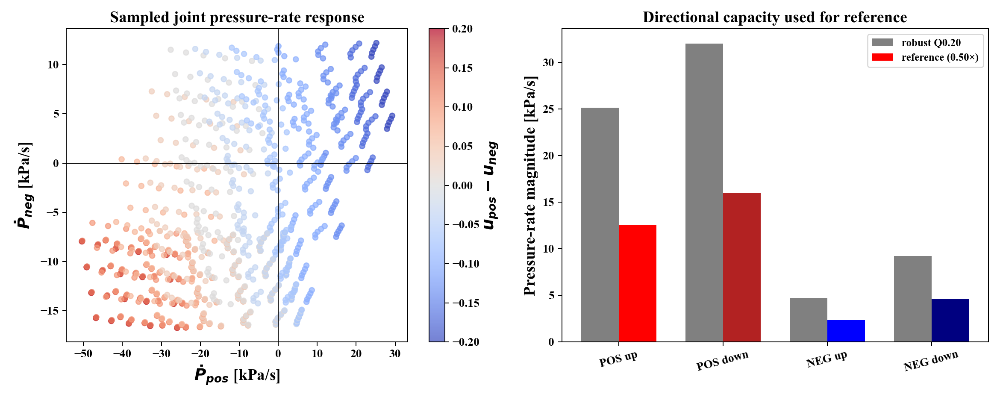
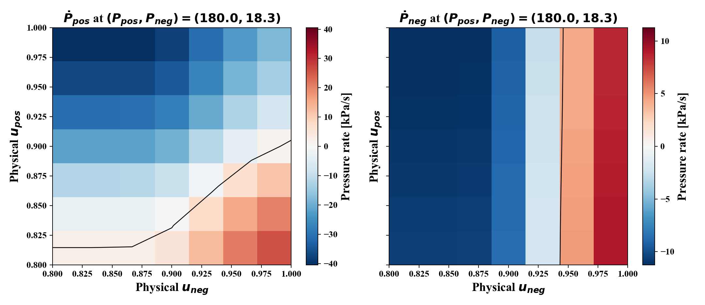

# lib2 reference 설계: 물리적 feasibility와 RL exploration 분리

## 1. 이 문서의 결론

현재 문제는 단순히 “random reference를 빠르게 만들 것인가, 느리게 만들 것인가”가 아니다. 다음 세 가지를 분리해야 한다.

1. 밸브가 만들 수 있는 유량
2. pump와 valve가 결합된 chamber pressure 변화율
3. RL이 충분한 방향·주파수·변화량을 경험하는가

따라서 reference는 다음 순서로 설계한다.

```text
valve/pump simulator equations
        ↓
state/action sweep
        ↓
empirical pressure-rate response map
        ↓
rate/state/input constraints
        ↓
smooth random reference
        ↓
SAC performance and exploration experiment
```

이번에 만든 `FeasibleRandomRef`는 최종 reference가 아니라, 먼저 reference 자체가 물리적으로 불가능해서 SAC가 실패하는지를 분리하기 위한 baseline이다. 현재 baseline은 보수적이며, 40.96초 episode에서 reference 변화가 적다는 문제가 있다. 그러므로 다음 단계에서는 `feasibility baseline`과 `exploration reference`를 분리해서 비교해야 한다.

관련 구현과 결과:

- [reference generator](../pneu_ref/src/pneu_ref/feasible_random_ref.py)
- [lib2 characterization script](../pneu_rl/scripts/design_lib2_reference.py)
- [generated profile](../pneu_rl/config/reference/lib2_feasible.yaml)
- [summary](../pneu_rl/exp/_analysis/lib2_reference_design/summary.yaml)
- [raw sweep CSV](../pneu_rl/exp/_analysis/lib2_reference_design/reachability.csv)
- [state-wise capacity CSV](../pneu_rl/exp/_analysis/lib2_reference_design/state_directional_capacity.csv)

## 2. 왜 reference feasibility를 먼저 확인하는가

Tracking reward는 일반적으로 reference와 measured pressure의 차이를 벌점으로 준다.

\[
r_t=-w_p\left\|P_t-P_t^{ref}\right\|^2
\]

그런데 reference가 plant가 낼 수 있는 pressure 변화보다 빠르면 policy가 아무리 좋은 action을 내도 순간적으로 오차가 생긴다.

이 경우 SAC reward가 개선되지 않는 이유는 다음 두 가지가 섞인다.

```text
reference가 물리적으로 불가능함
              +
policy가 좋은 action 조합을 아직 찾지 못함
```

두 원인을 분리하지 않으면 SAC, CAPS, MPObs, exploration 중 무엇이 문제인지 판단할 수 없다.

따라서 먼저 같은 SAC에 대해:

1. 기존 legacy random reference
2. 물리적으로 제한한 feasible reference

를 비교한다. feasible reference에서만 reward/RMSE가 개선되면 기존 실패에는 reference infeasibility가 포함되어 있었다고 해석할 수 있다. feasible reference에서도 실패하면 그때 SAC architecture, action parameterization, observation, exploration을 원인으로 좁힌다.

## 3. lib2 plant의 실제 pressure 식

### 3.1 Valve flow

밸브 유량은 개략적으로 다음 함수다.

\[
q_v=f(P_{in},P_{out},u,z,x_1,x_2)
\]

여기서:

- (P_{in}): 밸브 입구 pressure
- (P_{out}): 밸브 출구 pressure
- (u): valve command
- (z): hysteresis/internal state
- (x_1,x_2): valve dynamic state

lib2 C++ 구현에서는 raw signal을 먼저 effective opening으로 바꾼다.

\[
u_{eff}=\operatorname{clip}(2(u-0.5),0,1)
\]

그 다음 current와 valve force를 계산한다.

\[
I=I_{max}u_{eff}
\]

\[
F=I+C_z z+C_pP_{in}-C_k
\]

effective area는 대략:

\[
A_{eff}
=
A_{max}\left(1+e^{-kF}\right)^{-\alpha}
\]

이고, static flow는:

\[
q_{static}=A_{eff}P_{in}\phi(P_{in},P_{out})
\]

이다. 이후 C++에서는 2차 valve dynamics와 hysteresis를 통과한 (q_{pred})를 사용한다.

실제 구현은 [pneumatic_CT.cpp:305](/home/rise/test/brl_window_v2/pneu_env/src/pneu_env/lib2/pneumatic_CT.cpp:305)부터 확인할 수 있다.

### 3.2 POS chamber

POS valve는 POS chamber에서 atmosphere로 빠져나가는 valve다.

```cpp
mdot_pos_valve = solenoid_valve(Ppos, ATM, pos_valve, ...);
```

따라서 다른 조건이 같다면 (u_{pos})가 커질수록 POS chamber에서 빠져나가는 유량이 커진다.

lib2의 net flow는:

\[
\dot m_{pos}
=
\dot m_{1,out}
+\dot m_{2,out}
-\dot m_{v,pos}
\]

이고 pressure rate는:

\[
\dot P_{pos}
=
\frac{RT_{out}1000}{V_1}\dot m_{pos}
\]

이다.

따라서 일반적인 local 관계는:

```text
u_pos 증가 → POS valve opening 증가 → POS pressure 감소 방향
u_pos 감소 → POS valve closing → POS pressure 증가 방향
```

입니다.

다만 현재 policy action은 raw `[0,1]`을 physical `[0.8,1.0]`으로 변환합니다. 그러므로 C++ 내부 기준으로는:

\[
u_{eff}=0.6\sim1.0
\]

만 탐색하며, POS valve를 완전히 닫은 action은 screening 범위에 포함되지 않습니다. POS pressure를 올리는 방향은 pump inflow가 valve outflow보다 클 때만 만들어질 수 있습니다.

### 3.3 NEG chamber

NEG valve는 atmosphere에서 NEG chamber로 들어가는 valve다.

```cpp
mdot_neg_valve = solenoid_valve(ATM, Pneg, neg_valve, ...);
```

NEG의 net flow는:

\[
\dot m_{neg}
=
-\dot m_{1,in}
-\dot m_{2,in}
+\dot m_{v,neg}
\]

이고:

\[
\dot P_{neg}
=
\frac{RT_{out}1000}{V_2}\dot m_{neg}
\]

이다.

따라서 일반적인 local 관계는:

```text
u_neg 증가 → atmosphere 유입 증가 → Pneg 증가 방향
u_neg 감소 → pump extraction 영향 증가 → Pneg 감소 방향
```

입니다.

실제 두 chamber의 식은 [pneumatic_CT.cpp:192](/home/rise/test/brl_window_v2/pneu_env/src/pneu_env/lib2/pneumatic_CT.cpp:192)부터 확인할 수 있다.

## 4. 왜 valve 최대 유량만 사용하지 않는가

질문의 지적처럼 개별 valve 유량은 주로 (P_{in},P_{out},u)의 함수다. 그러나 우리가 reference로 만들고 싶은 값은 valve flow가 아니라 chamber pressure다.

현재 plant에는 다음 경로가 동시에 존재한다.

```text
P1, P2, pump angle
        ↓
pump/orifice mass flow
        ↓
chamber net mass flow
        ↑
valve mass flow
        ↓
chamber pressure rate
```

따라서 valve flow만 사용하면 다음 항을 빠뜨린다.

\[
\dot m_{1,out},\quad
\dot m_{2,out},\quad
\dot m_{1,in},\quad
\dot m_{2,in}
\]

예를 들어 valve flow가 동일하더라도 (P_1,P_2)가 달라지면 pump flow가 달라지고, 최종 (dot P)도 달라진다.

정확한 구분은 다음과 같다.

| 알고 싶은 것 | 필요한 모델 |
|---|---|
| valve가 만들 수 있는 최대 유량 | (P_{in},P_{out},u), valve internal dynamics |
| chamber가 만들 수 있는 최대 pressure rate | valve + pump + chamber volume + internal states |
| 실제 RL tracking 가능성 | 위 항목 + observation/history + action scaling |

따라서 `optimizer.py`의 valve fitting 결과는 필요하지만, reference rate 한계는 그 valve model을 포함한 전체 simulator에서 구해야 한다.

## 5. Sweep이란 무엇인가

Sweep은 가능한 입력을 격자로 나누고 모든 조합을 반복 측정하는 방식이다.

이번 lib2 설정은:

```text
initial POS pressure: 140, 160, 180, 200, 220 kPa
initial NEG pressure: 15, 18.3, 21.7, 25 kPa
raw POS action: 7개
raw NEG action: 7개
```

따라서:

\[
5\times4\times7\times7=980
\]

개 조건을 시험했다.

각 조건에서는 [design_lib2_reference.py:101](/home/rise/test/brl_window_v2/pneu_rl/scripts/design_lib2_reference.py:101)에서 다음 절차를 수행한다.

1. (P_{pos},P_{neg}) 초기화
2. `set_init_env()`가 (P_1,P_2)를 추정
3. 같은 action pair를 0.35초 warm-up 동안 적용
4. 이후 0.25초 동안 pressure 변화 측정
5. 유한차분으로 (dot P_{pos},dot P_{neg}) 계산

따라서 이번 결과는 장시간 carry 상태의 모든 pump/valve history를 포함한 exact reachable set이 아니다. 정확한 표현은:

> 지정한 pressure grid와 simulator 초기화 규칙에서 측정한 empirical pressure-rate response map

이다.

## 6. Robust plant capacity 산정

### 6.1 상태별 directional capacity

하나의 초기 상태 (x)에서 모든 action pair를 측정한 뒤 POS 상승 capacity를 다음처럼 정의한다.

\[
c_{pos}^{up}(x)
=
\max_{u}\max(\dot P_{pos}(x,u),0)
\]

POS 하강 capacity는:

\[
c_{pos}^{down}(x)
=
\max_{u}\max(-\dot P_{pos}(x,u),0)
\]

NEG도 동일하게 계산한다.

### 6.2 왜 raw maximum을 바로 사용하지 않는가

한 상태에서 나온 raw maximum은 다음 조건에 의존한다.

- 특정 pressure 상태
- 특정 action pair
- 특정 pump angle
- 특정 valve internal state
- 특정 초기화 방식

그 최대값을 모든 상태에서 쓸 수 있다고 가정하면 reference가 쉽게 saturation에 걸릴 수 있다.

그래서 상태별 최대 capacity들을 모아 낮은 quantile을 사용한다.

\[
C_i^d
=
Q_{0.20}\left(\{c_i^d(x)\}_{x\in\mathcal X}\right)
\]

여기서 Q0.20은 “capacity의 20%”가 아니다. 상태별 capacity를 정렬했을 때 낮은 쪽 20% 위치의 값이다.

이 선택은 공학적 robust screening 기준이다. 모든 상태에서의 엄밀한 보장을 원한다면 quantile 대신 minimum을 사용해야 한다.

### 6.3 왜 capacity의 50%인가

reference rate는:

\[
v_{ref,i}^d=\eta_P C_i^d
\]

로 정했다.

첫 기준에서는 (eta_P=0.5)를 사용했다. 이것은 다음 불확실성을 위한 여유다.

- sweep되지 않은 full-state history
- pump/valve hysteresis
- action grid 사이의 interpolation 오차
- simulator와 real system 차이
- observation delay와 control delay
- action saturation 및 policy의 추정 오차

하지만 50%는 이론적으로 유일한 값이 아니다. 따라서 다음 단계에서는:

\[
\eta_P\in\{0.5,0.7,0.9\}
\]

를 비교해야 한다.

- 0.5: feasibility 원인 분리
- 0.7: exploration을 더 요구하는 reference
- 0.9: plant limit에 가까운 stress test

현재 profile의 capacity 결과는 다음과 같다.

| Direction | Robust plant capacity | 50% reference limit |
|---|---:|---:|
| POS up | 25.119 kPa/s | 12.560 kPa/s |
| POS down | 32.010 kPa/s | 16.005 kPa/s |
| NEG up | 4.740 kPa/s | 2.370 kPa/s |
| NEG down | 9.246 kPa/s | 4.623 kPa/s |

## 7. 첫 번째 그림 해석



### 왼쪽 scatter plot

- x축: (dot P_{pos})
- y축: (dot P_{neg})

각 점 하나는 한 가지 초기 pressure와 한 가지 action pair를 simulator에 넣은 결과다.

| 위치 | 의미 |
|---|---|
| 오른쪽 | POS pressure 증가 |
| 왼쪽 | POS pressure 감소 |
| 위쪽 | NEG absolute pressure 증가 |
| 아래쪽 | NEG absolute pressure 감소 |

색은 (u_{pos}-u_{neg})다.

- 붉은색: (u_{pos})가 상대적으로 큼
- 푸른색: (u_{neg})가 상대적으로 큼

이 그림은 valve command와 pressure가 단순히 1:1 대응한다는 뜻이 아니다. pump flow와 valve flow가 합쳐진 최종 net pressure rate를 표시한다.

또한 점 구름이 직사각형 전체를 채우지 않는 것은 POS와 NEG 변화율을 독립적으로 마음대로 선택할 수 없다는 뜻이다.

### 오른쪽 bar plot

- 회색: 상태별 capacity의 Q0.20
- 색 막대: 회색 capacity의 50%

색 막대는 reference trajectory가 반드시 그 값까지 계속 사용한다는 뜻이 아니다. reference가 넘지 않아야 할 최대 rate ceiling이다.

### Action heatmap



heatmap은 representative state ((P_{pos},P_{neg})=(180,18.3))에서 action pair를 직접 확인한 것이다.

- 세로축: physical (u_{pos})
- 가로축: physical (u_{neg})
- 색: pressure rate
- 검은 선: pressure rate가 0이 되는 대략적인 경계

POS heatmap에서는 대체로 (u_{pos})가 커질수록 (dot P_{pos})가 감소한다. NEG heatmap에서는 (u_{neg})가 커질수록 (dot P_{neg})가 증가한다. 하지만 다른 valve와 pump 항 때문에 완전히 독립적이지 않다.

## 8. Cartesian product와 convex hull

### Cartesian product

각 축을 독립적으로 정리하면:

```text
POS rate: -16 ~ +12 kPa/s
NEG rate: -4.6 ~ +2.4 kPa/s
```

이 두 범위의 모든 조합으로 만든 직사각형을 Cartesian product라고 한다.

\[
\mathcal C
=
\mathcal C_{pos}\times\mathcal C_{neg}
\]

그러나 실제 plant가 그 직사각형 안의 모든 점을 만들 수 있다는 보장은 없다. 예를 들어 POS를 빠르게 올리면서 동시에 NEG도 빠르게 올리는 조합은 pump/valve coupling 때문에 불가능할 수 있다.

### Convex hull

실제 측정 point들을 고무줄로 감싼 가장 작은 볼록 다각형이 convex hull이다.

원하는 rate vector:

\[
v_{ref}=\left(\dot P_{pos}^{ref},\dot P_{neg}^{ref}\right)
\]

가 convex hull 밖에 있으면 현재 측정된 action-rate 조합으로 만들기 어렵다고 볼 수 있다.

현재 구현은 Cartesian product 또는 convex hull을 reference generator에 직접 넣지 않았다. 각 channel의 directional rate만 제한한다. 따라서 이후 더 공격적인 reference를 만들 때는 pressure별 2차원 reachable set 또는 convex hull 검사를 추가하는 것이 다음 개선점이다.

## 9. FeasibleRandomRef의 수학적 설계

### 9.1 기존 RandomRef의 문제

기존 reference는:

\[
r(t)=A_k\sin(2\pi t/T_k)+B_k
\]

형태다.

문제는 (A_k,B_k,T_k)를 다시 뽑는 순간 reference가 jump할 수 있다는 것이다. 각 sine의 주파수가 낮더라도 parameter switching 순간의 변화율은 매우 커질 수 있다.

이는 step reference와 다르다. step test에서는 의도적으로 불연속을 주지만, training random reference에서 불연속이 반복되면 reward의 상당 부분이 plant가 물리적으로 피할 수 없는 transient error가 된다.

### 9.2 Random waypoint

`FeasibleRandomRef`는 target pressure를 random하게 선택한다.

현재 profile에서는:

```text
POS target: 140–220 kPa
NEG target: 15–25 kPa
hold time: 1.5–4.0 s
seed: 61098
```

따라서 random성은 다음에서 발생한다.

- POS target offset
- NEG target offset
- 다음 target까지의 hold time
- seed에 따른 target sequence

단, 현재 구현은 매 segment마다 전체 범위에서 target을 뽑는다. 초기 pressure가 101.325 kPa이므로 첫 40.96초에는 긴 transition 하나만 보일 수 있다. 이것은 현재 baseline의 한계다.

### 9.3 Quintic minimum-jerk transition

현재 target (P_0)에서 다음 random target (P_1)로 바로 jump하지 않고:

\[
P(t)=P_0+(P_1-P_0)s(\tau)
\]

로 이동한다.

\[
\tau=\frac{t}{T}
\]

여기서 (s(	au))는 다음 5차 다항식이다.

\[
s(\tau)=10\tau^3-15\tau^4+6\tau^5
\]

이 식은 다음 6개 boundary condition을 만족시키도록 구한다.

\[
s(0)=0,\quad s(1)=1
\]

\[
s'(0)=0,\quad s'(1)=0
\]

\[
s''(0)=0,\quad s''(1)=0
\]

일반 5차식:

\[
s=a_0+a_1\tau+a_2\tau^2+a_3\tau^3+a_4\tau^4+a_5\tau^5
\]

에 boundary condition을 넣으면:

\[
a_0=a_1=a_2=0
\]

\[
a_3+a_4+a_5=1
\]

\[
3a_3+4a_4+5a_5=0
\]

\[
6a_3+12a_4+20a_5=0
\]

이고, 이를 풀면:

\[
a_3=10,\qquad a_4=-15,\qquad a_5=6
\]

이다.

### 9.4 1.875와 rate constraint

\[
s'(\tau)=30\tau^2(1-\tau)^2
\]

이고 최대값은 (	au=0.5)에서:

\[
s'(0.5)=30(0.5)^2(0.5)^2=1.875
\]

이다.

따라서:

\[
\left|\dot P\right|_{max}
=
\frac{1.875|P_1-P_0|}{T}
\]

이다.

plant가 허용하는 방향별 rate가 (v^d)라면:

\[
T
\ge
\frac{1.875|P_1-P_0|}{v^d}
\]

로 설정해야 한다.

현재 generator는 POS와 NEG 중 더 긴 시간이 필요한 channel에 맞춰 공통 transition duration을 사용한다.

## 10. Frequency constraint의 이론적 의미

현재 frequency constraint는 hard physical theorem이 아니다. valve natural frequency를 기준으로 reference가 너무 빠르지 않도록 만든 engineering prior다.

compiled lib2 valve에서 사용한 최소 natural frequency는:

\[
\omega_{n,min}=11\ {
m rad/s}
\]

이고:

\[
f_{n,min}=\frac{11}{2\pi}=1.751\ {
m Hz}
\]

이다.

첫 baseline은 그 10%인:

\[
f_{ref,max}=0.175\ {
m Hz}
\]

를 사용했다.

이것은 transition 시간 조건으로:

\[
T\ge\frac{1}{2f_{ref,max}}
\]

를 추가하는 방식이다.

최종적으로는 valve natural frequency가 아니라 전체 pressure plant의 closed-loop/open-loop frequency response를 측정해야 한다. 특히 pneumatic system에서는 pump, chamber compliance, delay, valve dynamics가 함께 들어가므로 valve (\omega_n)만으로 pressure bandwidth를 확정할 수 없다.

이 설계 방향은 actuator가 빠르게 따라갈 수 없는 command를 smooth하게 shaping하는 input-shaping 연구와 연결된다. 다만 여기서 구현한 것은 정식 input shaper나 closed-loop reference governor가 아니라, pressure-rate 기반의 단순한 feedforward command shaping이다.

## 11. 현재 feasible reference가 너무 쉬운 이유

현재 initial pressure는 약 101.325 kPa이고 NEG target은 15–25 kPa다.

최대 NEG 변화량은 약:

\[
101.325-15=86.325\ {
m kPa}
\]

이다.

NEG down reference limit이 약 4.623 kPa/s이므로:

\[
T
\ge
\frac{1.875\times86.325}{4.623}
\approx35.0\ {
m s}
\]

가 필요하다.

따라서 40.96초 episode에서는:

```text
initial hold
→ 약 35초의 하나의 긴 transition
→ 짧은 hold
```

만 발생할 수 있다.

이것은 feasibility 확인에는 유리하지만 exploration에는 부족하다. 이 reference만 보고 SAC가 충분히 exploration했다고 결론 내리면 안 된다.

### 다음 exploration reference 제안

feasibility baseline 이후에는 별도의 exploration profile을 사용한다.

```text
POS range: 140–220 kPa
NEG range: 15–25 kPa
capacity factor: 0.7
hold: 1–2 s
local waypoint delta 제한
episode_carry_state=True
```

여기서 local waypoint는 매번 전체 범위에서 target을 뽑지 않고:

```text
180 → 195 → 170 → 205 kPa
```

처럼 현재 target 근처에서 다음 target을 뽑는 방식이다.

이렇게 하면 전체 operating range는 유지하면서 한 transition이 너무 커지는 것을 막고, 40.96초 안에 여러 방향 전환을 넣을 수 있다.

실험 순서는 다음이 논리적이다.

| 단계 | 목적 |
|---|---|
| legacy reference | 기존 조건 재현 |
| feasible, factor 0.5 | reference infeasibility 분리 |
| feasible, factor 0.7 | exploration 난이도 증가 |
| feasible, local waypoint | episode 내 변화 횟수 증가 |
| full-range 15–30 | boundary/controllability stress test |

## 12. Full-range 결과 해석

NEG 범위를 15–30 kPa로 넓혀 sweep하면 결과는:

| Direction | Easy range 15–25 | Full range 15–30 |
|---|---:|---:|
| POS up | 25.119 | 25.402 |
| POS down | 32.010 | 31.991 |
| NEG up | 4.740 | 1.374 |
| NEG down | 9.246 | 9.230 |

특히 NEG-up capacity가 크게 감소한다.

상태별로 보면 대략:

```text
Pneg = 15 kPa: NEG-up 약 10–12 kPa/s
Pneg = 20 kPa: 약 7–9 kPa/s
Pneg = 25 kPa: 약 3.5–5 kPa/s
Pneg = 30 kPa: 약 0–1.5 kPa/s
```

이는 Pneg가 30 kPa 근처에 가까워질수록 현재 action range에서 pressure를 더 올릴 authority가 사라진다는 뜻이다.

따라서:

```text
15 → 30으로 한 번 이동
```

은 가능할 수 있지만:

```text
15 → 30 → 20 → 30 → 15
```

와 같은 반복 random tracking은 어려울 수 있다.

이 현상은 단순 exploration 실패가 아니라 다음 중 하나일 수 있다.

- 현재 physical action 범위에서 NEG-up authority 부족
- pump extraction과 valve inflow의 equilibrium
- (P_{neg})에 따른 nonlinear flow reduction
- pump/valve internal state의 영향

관련 자료:

- [full-range summary](../pneu_rl/exp/_analysis/lib2_reference_design/full_range_15_30/summary.yaml)
- [full-range capacity map](img/reference_design/full_range_15_30/lib2_rate_capacity_by_pressure.png)

## 13. 이 설계의 이론적 근거와 한계

### 13.1 Minimum jerk

Flash와 Hogan은 trajectory의 jerk 제곱을 최소화하는 동작이 smooth trajectory를 설명할 수 있음을 제시했고, 그 결과가 quintic minimum-jerk polynomial로 나타난다. 이 논문은 pneumatic system을 다룬 것은 아니므로 “이 식이 우리 plant에 최적”이라는 증명은 아니다. 여기서는 abrupt reference jump를 줄이는 합리적인 trajectory parameterization으로 사용한다.

- [Flash & Hogan, 1985, The coordination of arm movements](https://pmc.ncbi.nlm.nih.gov/articles/PMC6565116/)
- [Kyriakopoulos & Saridis, Minimum jerk for trajectory planning and control](https://doi.org/10.1017/S0263574700016696)

### 13.2 Input shaping과 bandwidth

Input shaping 연구에서는 actuator dynamics와 vibration/bandwidth를 고려해 command를 smooth하게 만들면 tracking ability가 개선될 수 있음을 다룬다. 우리 구현은 정식 input shaper는 아니지만, “actuator가 따라갈 수 없는 빠른 command를 그대로 넣지 않는다”는 방향은 동일하다.

- [Input shaping reference commands for trajectory following Cartesian machines](https://doi.org/10.1016/j.conengprac.2004.09.011)
- [Smooth and robust multi-mode shaped commands](https://doi.org/10.1016/j.ymssp.2021.108658)

### 13.3 Reference governor와 constraint handling

Reference governor는 원하는 reference를 그대로 적용하지 않고 state/control constraint를 만족하도록 reference의 evolution을 수정한다. Gilbert와 Kolmanovsky의 nonlinear generalized reference governor 연구는 nonlinear system과 state/control constraints를 다룬다.

현재 `FeasibleRandomRef`는 formal reference governor가 아니다. plant state feedback으로 매 순간 target을 수정하지 않고, characterization 결과를 사용해 사전에 rate와 transition time을 제한한다. 따라서 현재 방식은:

```text
offline empirical reference shaping
```

이고, 다음 단계에서 formal governor나 online feasibility check로 확장할 수 있다.

- [Gilbert & Kolmanovsky, Fast reference governors](https://hdl.handle.net/2027.42/35139)
- [Gilbert & Kolmanovsky, Generalized reference governor for nonlinear systems](https://doi.org/10.1016/S0005-1098(02)00135-8)

### 13.4 Exploration과 persistent excitation

물리적으로 feasible한 reference라고 해서 exploration이 충분한 것은 아니다. reference가 너무 느리거나 한 방향으로만 움직이면 policy가 필요한 action 조합을 경험하지 못한다.

반대로 white noise나 abrupt random step은 많은 주파수를 포함하지만 pneumatic plant가 따라가지 못할 수 있다. 따라서 exploration reference는 다음 두 조건을 동시에 만족해야 한다.

\[
\text{feasible under plant constraints}
\]

그리고:

\[
\text{sufficiently varying for policy learning}
\]

현재 feasible baseline은 첫 번째 조건을 우선한 것이다. 두 번째 조건을 확인하려면 episode 내:

- target direction 전환 횟수
- reference slew 분포
- action distribution
- action pair coverage
- pressure-rate quadrant coverage
- replay buffer의 state/action 다양성

을 별도로 측정해야 한다.

Persistence of excitation 문헌은 입력 신호가 충분한 정보를 포함해야 system identification이나 adaptive control에서 input-output map을 구분할 수 있다고 설명한다. 다만 여기서 random pressure reference가 formal PE 조건을 만족한다고 주장하는 것은 아니다. 우리의 SAC exploration reference는 frequency spectrum과 action coverage를 측정하여 경험적으로 검증해야 한다.

- [On the notion of persistence of excitation for linear switched systems](https://doi.org/10.1016/j.nahs.2022.101308)

## 14. 최종 실험 기준

### A. Reference 원인 분리

동일 pure SAC에 대해:

1. legacy reference
2. feasible factor 0.5

를 같은 seed, horizon, reward, observation, action scaling, carry 조건으로 학습한다.

기록할 값:

- episode reward
- POS/NEG RMSE
- POS/NEG bias
- reference max slew
- pressure max slew
- reference-rate utilization
- action saturation ratio
- pressure-rate quadrant coverage

### B. Feasibility factor 실험

feasible reference에 대해:

\[
\eta_P=0.5,0.7,0.9
\]

를 비교한다.

해석은 다음과 같다.

| 결과 | 해석 |
|---|---|
| 0.5도 실패, 0.7/0.9도 실패 | architecture/exploration/observation 문제 가능성 |
| 0.5 성공, 0.7 실패 | plant capacity 근처에서 policy가 saturation 또는 exploration 실패 |
| 0.5 성공, 0.7 성공 | 기존 reference가 너무 어려웠을 가능성 |
| 0.9에서만 실패 | capacity margin이 부족함 |

### C. Carry 실험

처음에는 carry=False로 reference 원인을 비교한다. 그 다음 feasibility가 확인되면 carry=True로 바꾼다.

carry=True에서는 episode가 physical reset이 아니라 RL bookkeeping boundary가 된다. 따라서 첫 episode의 긴 초기 transition 이후 다음 episode에서 reference와 pump/valve history가 이어진다. 이것이 exploration reference에는 더 적합할 수 있다.

### D. Full-range stress test

마지막에 NEG 25–30 kPa를 별도 stress test로 사용한다. 이 범위에서 NEG-up authority가 사라지면 SAC 실패라고 결론 내리지 말고, 먼저 action-rate heatmap과 full-state carry rollout을 확인한다.

## 15. Reference 재생성 명령어

현재 easy baseline profile 재생성:

```bash
PYTHONPATH= MPLCONFIGDIR=/tmp/matplotlib_ref_design \
python3 pneu_rl/scripts/design_lib2_reference.py \
  --pos-grid 140,160,180,200,220 \
  --neg-grid 15,18.333,21.667,25 \
  --profile-neg-max 25
```

학습:

```bash
OMP_NUM_THREADS=2 MKL_NUM_THREADS=2 OPENBLAS_NUM_THREADS=2 \
PYTHONPATH= python3 pneu_rl/scripts/train_screening.py \
  --lib 2 \
  --variant sac \
  --seed 0 \
  --episodes 1000 \
  --horizon 2048 \
  --reference-profile pneu_rl/config/reference/lib2_feasible.yaml \
  --name 260724_lib2_sac_feasible_ref_seed0
```

검증:

```bash
PYTHONPATH= python3 pneu_rl/scripts/evaluate_screening.py \
  --model 260724_lib2_sac_feasible_ref_seed0 \
  --steps 2048
```

평가 결과에는 RMSE와 reward뿐 아니라 reference-rate utilization과 violation ratio도 저장된다.

## 16. 최종 판단

현재 설계는 다음 논리로 채택되었다.

1. valve flow만으로는 chamber pressure feasibility를 판단할 수 없으므로 전체 simulator의 net pressure rate를 측정한다.
2. 특정 상태의 raw maximum은 history와 operating point에 민감하므로 상태별 capacity의 낮은 quantile을 사용한다.
3. 모델 오차와 saturation 여유를 위해 capacity의 50%를 첫 baseline으로 사용한다.
4. abrupt random reference는 plant가 따라갈 수 없는 순간 오차를 만들 수 있으므로 rate-limited smooth trajectory로 바꾼다.
5. quintic minimum-jerk polynomial은 시작/끝의 velocity와 acceleration을 0으로 만들며, 최대 slope를 계산할 수 있어 pressure-rate constraint를 직접 반영할 수 있다.
6. 다만 feasibility와 exploration은 서로 다른 목표이므로, 현재 profile을 최종 reference로 고정하지 않고 factor와 local waypoint를 증가시키는 후속 실험이 필요하다.

즉 현재 profile은 “좋아 보여서 선택한 reference”가 아니라:

```text
simulator equations
→ measured directional capacity
→ conservative constraint
→ analytically rate-limited trajectory
```

라는 근거로 만든 첫 번째 baseline이다. 이후 (\eta_P), waypoint 변화량, carry, action coverage를 실험으로 검증해야 최종 RL training reference라고 부를 수 있다.
