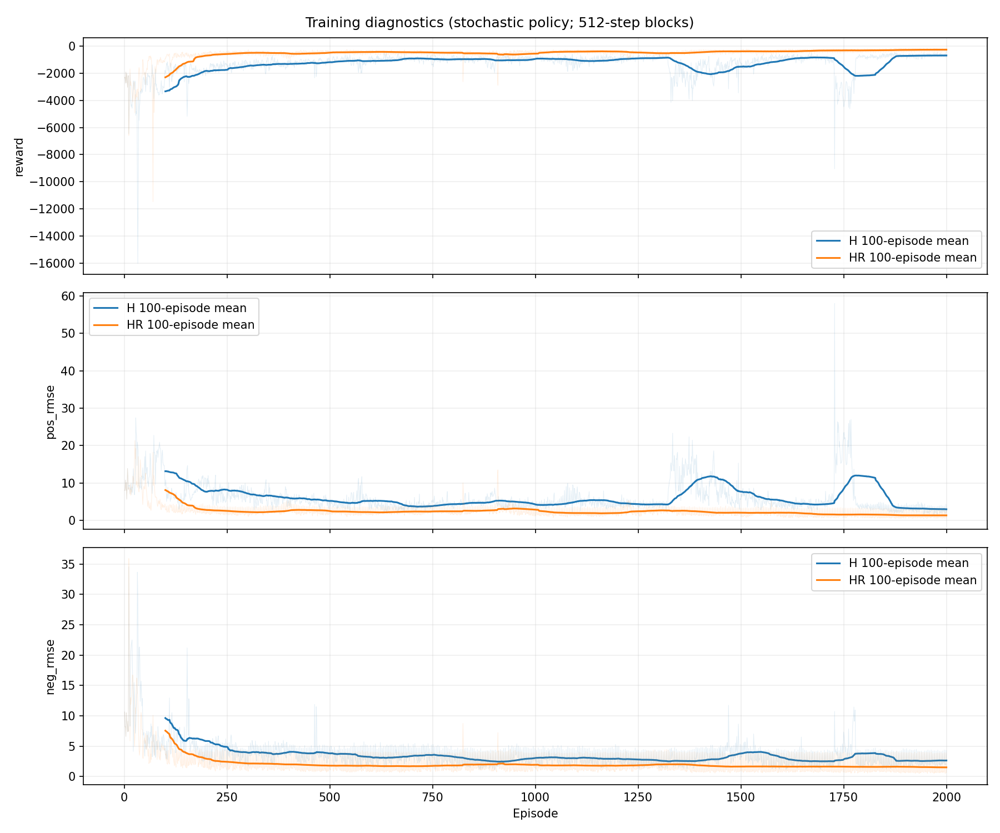
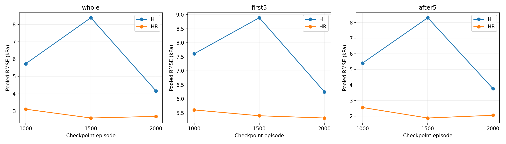
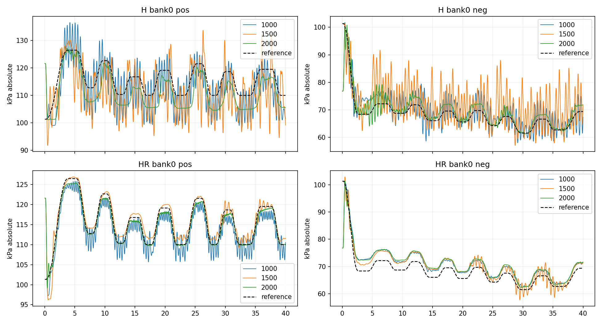
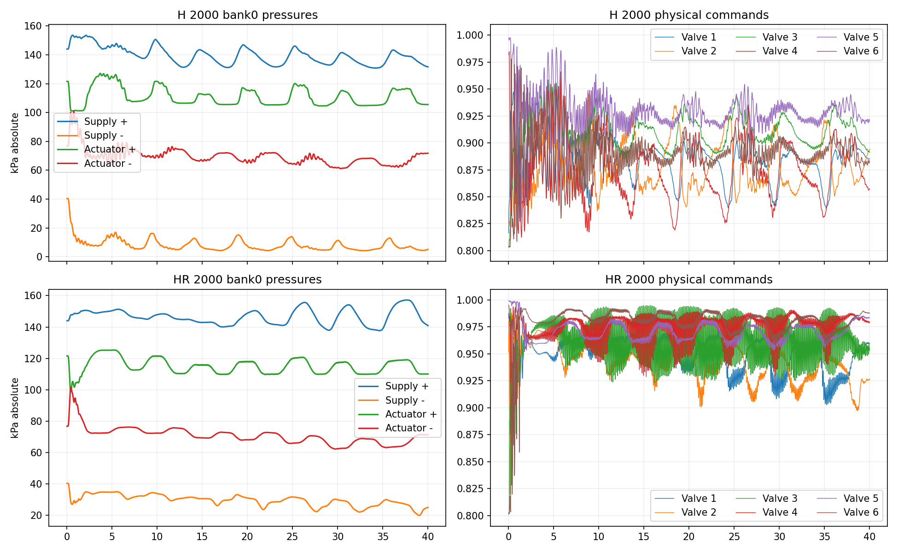
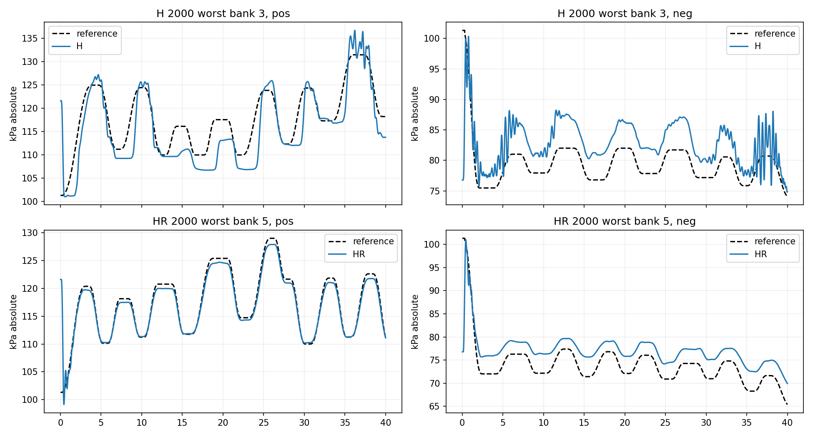

# Lib3 전체 개방 초기화 학습 결과 검토 — 2026-10-16

두 모델 모두 2000 episode 학습을 완료했다. 새 모델 중에서는 HR이 유리하지만,
전체 개방 초기화를 학습했다는 이유만으로 기존 HR보다 좋아졌다고 결론낼 수 없다.
H 2000은 공급 음압 챔버 운전 범위 이탈 때문에 실물 후보로 바로 권하지 않는다.

## 완료 및 검증 범위

| 모델 | 완료 시각(KST) | 소요 시간 | episode / policy steps |
|---|---|---|---|
| H | 10월 16일 00:45:51 | 4시간 16분 31초 | 2000 / 1,024,000 |
| HR | 10월 16일 00:48:14 | 4시간 18분 49초 | 2000 / 1,024,000 |

- 경로: `pneu_rl/models/261015_lib3_allopen30_{H,HR}_smooth_seed0/`.
- `wall_time.json`의 completed=true, threads=2, 2000 episode 확인.
- 두 `train_diagnostics.csv`는 episode 1~2000이 연속이고 결측값이 없다.
- 1000/1500/2000 체크포인트 총 6개에서 각각 93개 tensor가 모두 유한값이다.
- 각 체크포인트를 학습 bank 16개에서 고정 정책으로 평가: 총 96회, 각 40초/2000 step.
  매 회 펌프 ON·전체 개방 30초 준비 후 물리 상태와 history를 유지하고 ref0부터 시작한다.
  준비 시간은 평가 시간에 포함하지 않는다. 정책 업데이트와 실물 제어는 하지 않았다.
- 이번 bank는 **학습 bank**다. 미학습 ref 일반화나 여러 seed의 통계적 우월성 검증은 아니다.
- 초기화/history/carry/reference clock 및 quick viz 40초 경로 테스트 5개 통과.
- 새벽 01:30 자동 검증은 시작됐지만 로컬 Codex가 ChatGPT 계정에서
  `gpt-6.1-sol` 모델을 지원하지 않는다는 오류로 종료했다. 예약 보고서는 생성되지 않았고,
  이 보고서는 이후 사용자 요청으로 직접 수행한 검증 결과다.

## 학습 그래프



가는 선은 episode별 값, 굵은 선은 최근 100 episode 평균이다. 학습은 탐색을 포함하며
512-step block과 carry 초기 조건이 섞이므로 고정 정책의 40초 평가와 수치를 직접 등치하지 않는다.

HR은 후반까지 개선되었다. 마지막 100 episode 평균 reward는 -260.32,
양/음압 RMSE의 episode 평균은 1.35/1.52 kPa다. H는 약 1400·1800 episode 주변에
양압 오차가 커졌다가 회복한다. 마지막 100 episode 평균 reward -688.18,
양/음압 RMSE 평균 2.98/2.65 kPa다. 이 그래프만으로 H의 성능 저하 원인은 특정할 수 없다.

## 동일 조건의 체크포인트 비교

아래 RMSE는 16개 ref의 모든 샘플과 양·음압 오차 제곱을 합쳐 계산한 값이다.
`전체 = sqrt(mean(error²))`이며 ref별 RMSE를 단순 산술평균한 값이 아니다.

| 모델 | episode | 전체 RMSE | 처음 5초 | 이후 35초 | 최악 ref 전체 RMSE | 챔버 범위 이탈 비율 |
|---|---:|---:|---:|---:|---:|---:|
| H | 1000 | 5.729 | 7.608 | 5.408 | 6.035 | 0% |
| H | 1500 | 8.383 | 8.893 | 8.307 | 9.646 | 0% |
| H | 2000 | 4.165 | 6.252 | 3.773 | 4.452 | **58.43%** |
| HR | 1000 | 3.109 | 5.607 | 2.560 | 3.241 | 0% |
| HR | 1500 | **2.601** | 5.399 | **1.888** | **2.829** | 0% |
| HR | 2000 | 2.694 | **5.319** | 2.063 | 3.012 | 0% |

단위 kPa. 범위 이탈은 해당 샘플에서 공급 챔버 둘 중 하나라도 cfg의 양압
101.325~220, 음압 10~101.325 kPa(절대압) 밖에 있는 비율이다.
이는 reward에 coefficient 0.1로 들어간 **soft penalty의 범위**이며 하드웨어 안전 한계의
검증이나 hard constraint 보장을 뜻하지 않는다.



HR 1500은 2000보다 전체 RMSE가 약 3.5% 작고, 16개 중 11개 ref에서 낫다.
반면 HR 2000은 6개 물리 명령의 평균 절대 step 변화량이 0.001508로,
1500의 0.002338보다 약 35.5% 작다. 추종 정확도와 명령 변화량 사이의 차이다.
이 수치 하나로 모든 고주파 진동이나 실물 내구성을 평가한 것은 아니다.

## 추종·공급 압력·명령 그래프



- H 1000/1500에는 지속적인 압력 진동이 크다. H 2000에서는 진동이 줄지만
  bank0 양압의 5초 이후 bias가 -4.93 kPa로 남는다.
- HR 2000 양압은 목표 형태를 잘 따라간다. 그러나 bank0 음압은 5초 이후
  평균 +2.68 kPa의 오프셋이 남는다(관측−목표, 즉 목표보다 덜 진공).
- 최초 actuator 압력은 약 121.6/76.8 kPa인데 ref는 대기압 부근에서 시작하므로
  시작 오차가 존재한다. 전체 RMSE와 초기 이후 RMSE를 모두 보고해야 한다.



H 2000의 공급 음압 최솟값은 전체 bank에서 **4.03 kPa**다. 16개 ref 모두에서
10 kPa 하한 위반이 있다. bank0만 보면 최솟값 4.29 kPa, 이탈 비율 74.35%다.
명령이 0~1 끝에 붙지 않아도 운전 압력은 범위를 벗어날 수 있다.

HR 1500/2000은 이번 전체 bank에서 챔버 범위 이탈이 없었다.
HR 2000의 공급 음압 최솟값은 19.93 kPa다. 다만 압력 그래프가 매끄러워도
밸브 명령에는 반복적인 잔진동이 남는다. 따라서 “제어 명령까지 매끄럽다”는 표현은 피한다.



## 기존 정책과의 비교: 초기화 재학습 효과를 과장하지 않기

기존 기록 `docs/img/lib3_all_open_start_20261015/metrics.csv`의 30초 준비,
bank0 40초 결과와 비교했다. 기존 기록은 평가용 준비 함수, 새 결과는 학습용
prepared environment를 사용한다. 두 초기 state/history의 일치는 회귀 테스트로 확인했다.
아래는 단일 bank 비교이며 기존 정책의 16개 bank 재평가를 수행한 것은 아니다.

| 정책 | bank0 전체 RMSE | 처음 5초 | 이후 35초 |
|---|---:|---:|---:|
| 기존 H 2000 + 전체 개방 준비 | 11.606 | 12.169 | 11.523 |
| 새 H 2000 | 4.370 | 6.187 | 4.044 |
| 기존 HR 2000 + 전체 개방 준비 | **2.028** | **5.369** | **0.763** |
| 새 HR 1500 | 2.725 | 5.590 | 2.005 |
| 새 HR 2000 | 2.755 | 5.512 | 2.082 |

H는 추종이 개선됐지만 챔버 범위 문제가 남았다. HR은 이 비교에서는 기존 정책이 더 낫다.
새로 학습한 seed 하나와 체크포인트 선택 결과이므로 “전체 개방 초기화가 HR을 악화시킨다”는
인과 결론도 아직 불가능하다. 확실한 결론은 **이번 재학습이 HR 개선의 증거는 아니라는 것**이다.

## 다음 실험 판단

1. 새 정책 중 **추종 정확도 우선 후보는 HR 1500**이다. 명령 변화량을 더 중시하면
   HR 2000도 함께 보존한다. 2000이 항상 최선이라는 가정은 버린다.
2. H 2000의 실물 적용은 보류하고 공급 음압 하한 이탈을 먼저 다룬다.
   H 1000은 이번 범위 이탈이 없지만 오차와 진동이 크므로 대체 배포 후보로 자동 승격하지 않는다.
3. 기존 HR 2000도 비교 기준으로 유지한다. 새 HR만 옮겨 실물 성공 여부를 초기화 학습 효과로
   해석하지 않는다. 필요하면 기존 HR도 동일 evaluator로 bank 전체 비교 후 후보를 좁힌다.
4. 실물 전에는 실제 관측으로 pressure/action history를 구성하고, ref 시간 원점을 정책 시작과
   맞추며, 센서 freshness와 실제 제어 간격을 확인해야 한다. Sim 초기화 수정만으로
   Real의 대기압 가상 history·16ms 간격 문제가 해결된 것은 아니다.
5. 현재 결과만으로 “이번엔 sim2real이 잘 된다”고 말할 수 없다. 우선 HR의 실물 입력 정합성을
   맞춘 짧은 zero-shot 검증으로 평가하고, 추가 장시간 학습은 결과를 보고 결정한다.

## 재현 및 산출물

- 평가 코드: `pneu_rl/scripts/review_lib3_all_open_training.py`
- 추가 그래프: `pneu_rl/scripts/plot_lib3_all_open_review.py`
- 요약/개별 지표: `docs/img/lib3_all_open_training_review_20261016/{summary,metrics}.csv`
- 완료 정보/체크포인트 SHA256: 같은 폴더 `audit.json`
- tensor 유한값 검사: 같은 폴더 `checkpoint_integrity.json`
- 96회 원본 시계열: `pneu_rl/exp/lib3_all_open_training_review_20261016/`
  (`sensor_time`은 준비 시간을 포함한 관측 시각, `time`은 정책 실행 경과 시간,
  `reference_time`은 step 직전 reference 조회 시각)

```bash
MPLCONFIGDIR=/tmp/brl_review_mpl OMP_NUM_THREADS=2 MKL_NUM_THREADS=2 OPENBLAS_NUM_THREADS=2 \
/home/rise/miniconda3/envs/env_1/bin/python pneu_rl/scripts/review_lib3_all_open_training.py
MPLCONFIGDIR=/tmp/brl_review_mpl \
/home/rise/miniconda3/envs/env_1/bin/python pneu_rl/scripts/plot_lib3_all_open_review.py
```

학습 모델, cfg, replay는 변경하지 않았다. 실제 장치 실행도 하지 않았다.
