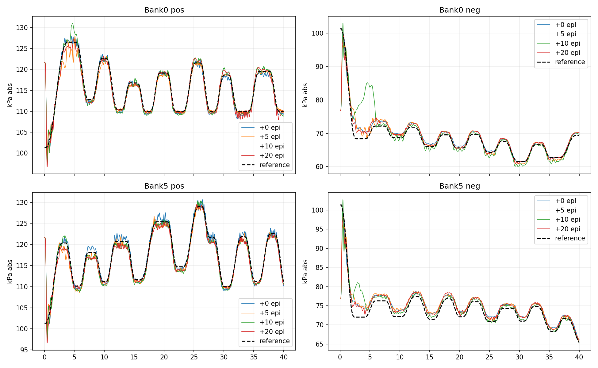
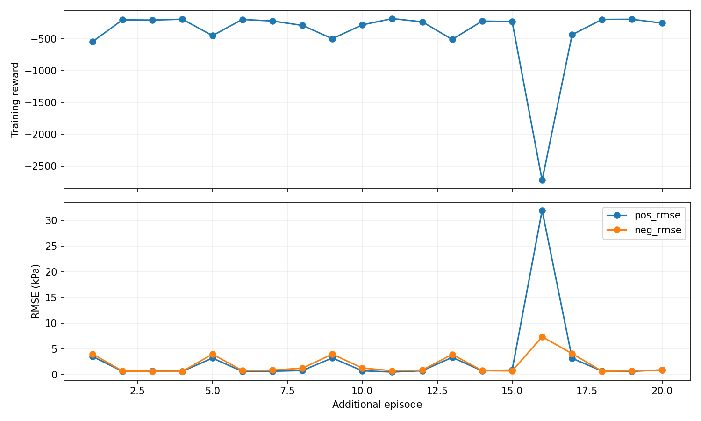
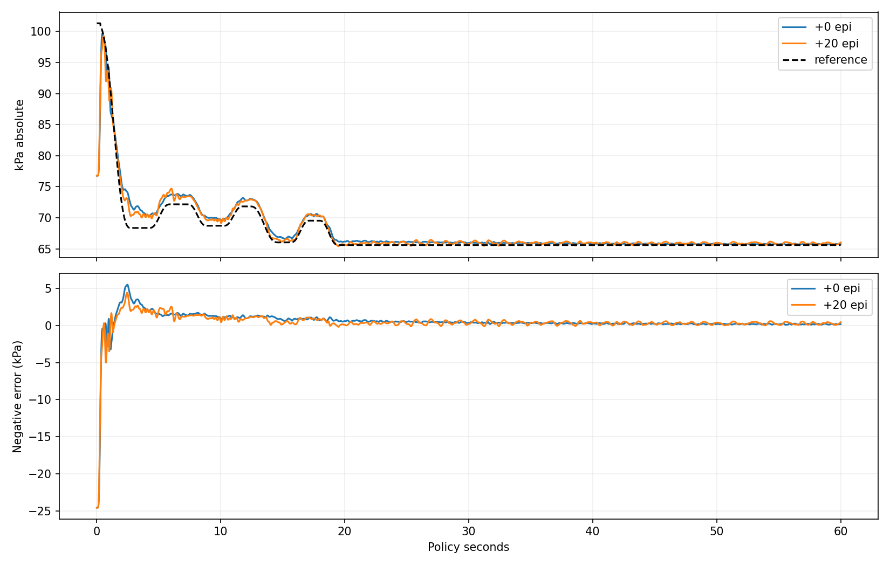

# 기존 HR의 전체 개방 조건 짧은 추가 학습 — 2026-10-16

**기존 HR에서 20 episode 이어 학습하면 이번 실험에서는 추종 성능이 대체로 유지된다.**
처음부터 학습한 새 HR의 큰 음압 잔류 오차도 재현되지 않았다.
그러나 원본보다 뚜렷하게 좋아진 것은 아니며, 명령 변화량과 고정 목표의 잔진동은 늘었다.
따라서 원본 HR을 추가 학습 모델로 자동 교체할 근거는 부족하다.

## 실험 조건

- 원본: `260831_lib3_histreward2x2_r025_HR_smooth_seed0/model_epi_2000.pth`.
- 별도 결과: `pneu_rl/models/261016_lib3_oldHR_allopen_short20_seed0/`.
- actor, critic, target critic, actor/critic Adam 상태와 log_alpha를 복원.
- 원본 checkpoint에 entropy optimizer 상태가 없어서 해당 optimizer는 새로 생성했다.
  과거 학습의 RNG/총 step/episode 이력을 완벽하게 복원한 resume는 아니다.
- replay는 새로 시작. 기존 HR의 stochastic policy로 2048 step을 먼저 수집하고 업데이트는 하지 않았다.
  이후 전체 개방 준비 상태에서 20 episode × 512 step 동안 10,240회 업데이트했다.
- 총 데이터 12,288 step: 50Hz 정책 시간으로 245.76초. 준비 운전 시간은 별도이며
  이를 실물 적응 시간으로 해석하지 않는다. 실물은 실행하지 않았다.
- reward, 학습률 0.0003, batch 128, 1 step당 업데이트 1회, observation, 기존 ref bank 유지.
  앞서 실험한 2초/5초 연결 ref는 이번 학습에 사용하지 않았다.
- 펌프 ON·전체 개방 30초 준비, history/물리 상태 유지, 정책 ref 시계는 0부터 시작.
- 고정 명령 warmup은 끄고 학습 중 정책 탐색을 사용. seed 0, threads 2.
- 사전 수집부터 학습/저장까지 127.03초. actor parameter 변화 L2=3.609로 실제 업데이트 확인.
- 원본 checkpoint SHA256을 전후 비교하여 변경 없음 확인.

## 평가 범위와 결과

고정 정책으로 매 회 동일한 전체 개방 초기화, 기존 reference, 40초를 실행했다.
추가 학습 0/20 episode는 **16개 bank 전체**, 5/10은 **bank 0·5 두 개만** 평가했다.
총 추종 rollout 36회와 고정 목표 진단 2회다. 평가 지표는 각자 다른 크기의 bank를
섞어 순위를 매기지 않는다. 모든 bank는 원래 학습 bank로, held-out 일반화 증거는 아니다.

16개 bank 전체 비교(양·음압 통합 pooled RMSE):

| 항목 | 업데이트 전 | +20 episode |
|---|---:|---:|
| 전체 RMSE (kPa) | 2.103 | 2.080 |
| 처음 5초 RMSE | 5.265 | 5.240 |
| 6초 이후 RMSE | 1.040 | 0.996 |
| 최악 bank 전체 RMSE | 2.216 | 2.138 |
| 6초 이후 음압 평균 bias (관측−목표) | +1.100 | +0.885 |
| 공급 챔버 설정 범위 이탈 비율 | 0% | 0% |
| 물리 명령 평균 절대 step 변화량 | 0.01418 | 0.01788 |

전체 RMSE는 약 **1.06% 감소**, 16개 중 13개 bank에서 감소했다.
반면 명령 변화량은 약 **26.1% 증가**했다. seed 하나의 기술적 비교이며
통계적 유의성이나 실물 성능 향상 주장은 아니다. 범위는 cfg의 soft penalty 기준
양압 101.325~220, 음압 10~101.325 kPa이고 하드웨어 안전 검증이 아니다.

bank0의 전체 RMSE는 0/5/10/20 episode에서 2.028/2.109/3.233/2.004 kPa였다.
10 episode에서는 초기 음압 과도응답이 크게 나빠졌다. 6초 이후 오차가 작아져도
전체 성능은 악화될 수 있으므로, 온라인 업데이트 도중 항상 좋은 제어가 유지된다는
보장은 이번 결과에 없다.

학습 reward는 16 episode에서 크게 떨어졌다. 학습은 stochastic policy와
512-step carry block을 사용하므로 frozen 40초 평가와 직접 동일시하지 않는다.

## 음압 정상 유지 오차

bank0를 20초까지 따른 뒤 양압 119.132, 음압 65.600 kPa 목표를 60초까지 고정했다.
마지막 50~60초를 비교한다. 앞서 수행한 기존/새 HR 진단과 같은 목표다.

| 항목 | 원본 HR | 원본에서 +20 episode |
|---|---:|---:|
| 음압 평균 오차 (kPa) | +0.168 | +0.267 |
| 음압 RMSE (kPa) | 0.172 | 0.306 |
| 음압 표준편차 (kPa) | 0.0386 | 0.1496 |

처음부터 학습한 새 HR1500/2000의 동일 진단 bias +2.567/+1.881 kPa보다 작다.
그러나 추가 학습이 원본의 고정 목표 성능을 개선한 것은 아니다. 작은 잔류 오차가 유지되는
대신 잔진동은 늘었다. 한 목표에 대한 진단이므로 모든 목표의 정상상태 성능으로 일반화하지 않는다.

## 해석과 다음 선택

1. 전체 개방 시작 조건이 HR의 작은 오차를 필연적으로 파괴하는 것은 아니다.
   기존 HR 가중치에서 시작하면 짧은 업데이트 후에도 작은 오차를 유지할 수 있었다.
2. 처음부터 학습한 새 HR의 오프셋은 단순한 현재 초기 상태 문제보다
   학습 경로/얻어진 정책 해와 관련됐을 가능성을 뒷받침한다. 단, 이번 실험은
   가중치뿐 아니라 critic/optimizer 상태도 복원하므로 무엇이 결정적이었는지는 분리하지 못했다.
3. **현재 기준 모델은 원본 HR 유지**가 합리적이다. +20 모델은 비교 후보로 보존한다.
   원본 대비 작은 RMSE 개선만으로 명령 변화량 증가와 정상 유지 진동 증가를 무시하지 않는다.
4. 추가로 수천 episode를 바로 돌릴 근거는 없다. 실물 zero-shot 이전에는 실제 history,
   ref 원점, 관측 주기를 맞춰야 한다. 이번 실험은 새로운 동역학 mismatch나 실제 drift에 대한
   빠른 적응 검증이 아니며, Sim 초기화 조건 변경에 대한 짧은 continuation 검사다.

## 산출물과 검증

- 실행 코드: `pneu_rl/scripts/check_lib3_hr_short_finetune.py`.
- 추가 학습 checkpoint 0/5/10/15/20 및 replay는 새 모델 폴더에 저장.
  `model_epi_0000.pth`는 원본 상태 복원 직후이며 추가 episode 번호가 0이라는 뜻이다.
  `model_epi_0020.pth`는 기존 2000 이후 추가 20 episode 모델이다.
- metadata: 결과 모델 `cfg.yaml`, `wall_time.json`; 문서 그림 폴더 `run.json`.
- 지표: `docs/img/lib3_hr_short_finetune_20261016/{metrics,summary,hold_metrics}.csv`.
- 원본 38개 평가 rollout: `pneu_rl/exp/lib3_hr_short_finetune_20261016/`.
- 5개 checkpoint의 모든 tensor 유한값, 20개 학습 episode, 실제 parameter 변화와
  10,240회 업데이트, 원본 hash 보존 확인. `checkpoint_integrity.json`에 검사 기록.
- 기존 모델 파일/학습 cfg와 실물 제어 코드는 변경하지 않았다.
- 스크립트는 같은 결과 폴더가 존재하면 덮어쓰지 않고 종료한다.
