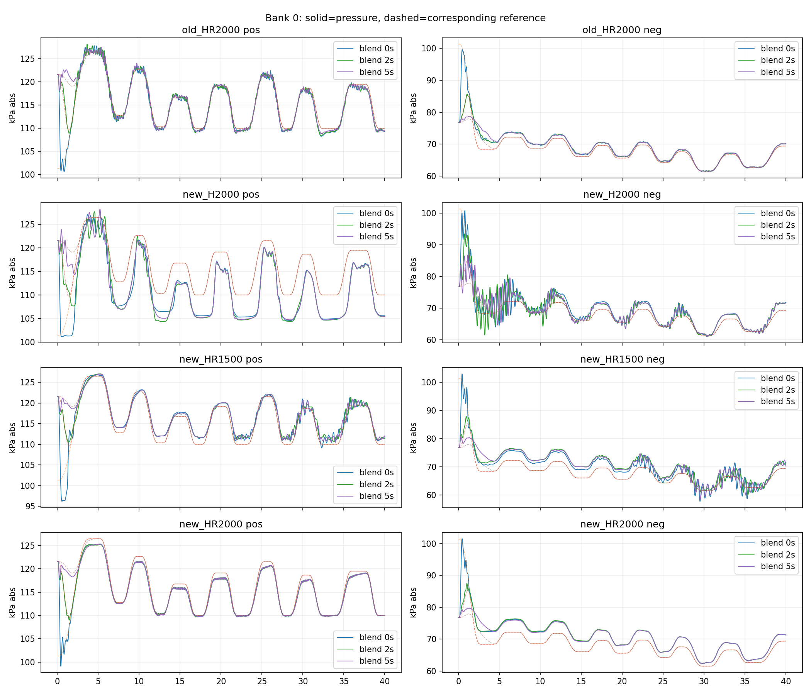
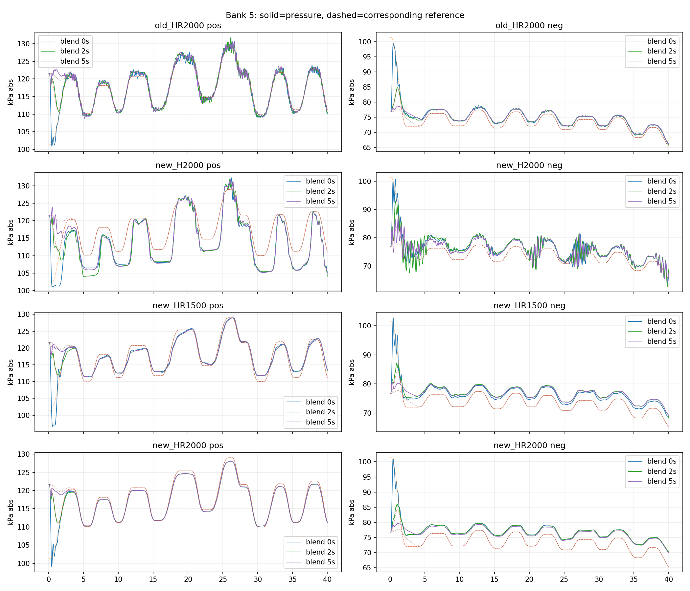
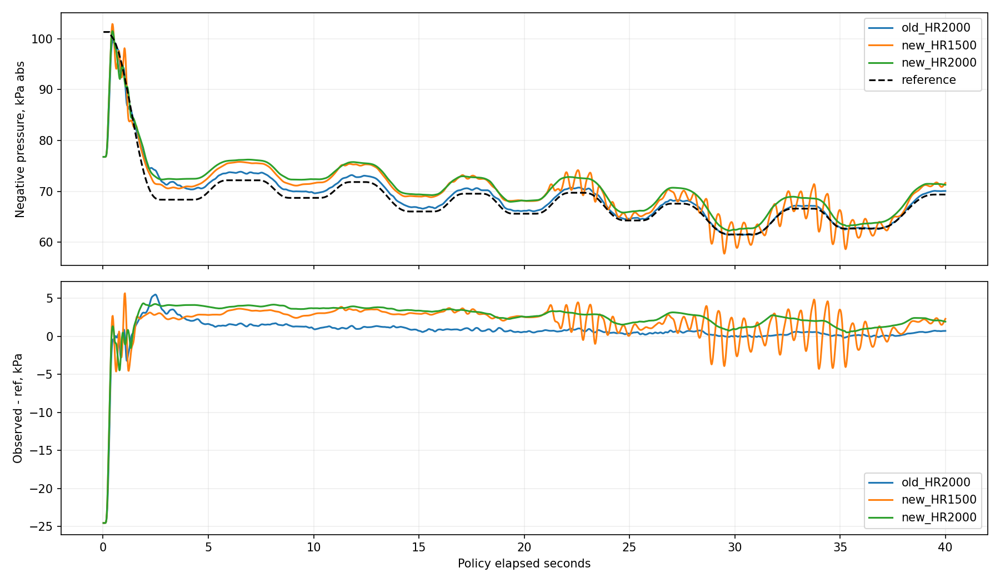
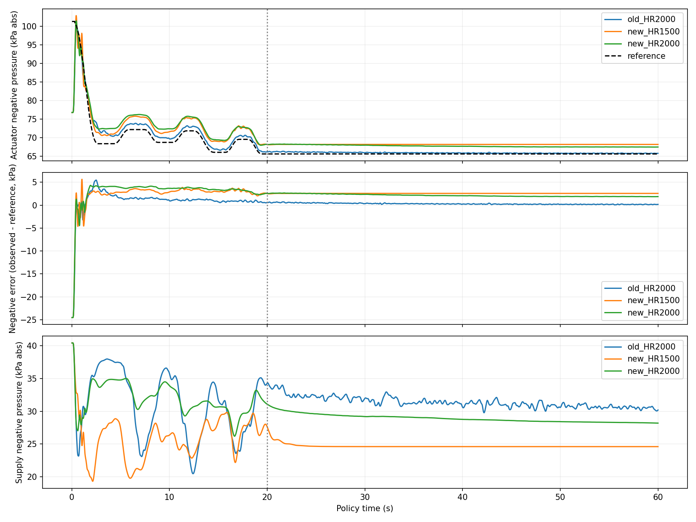

# Reference 시작 연결 비교와 HR 음압 잔류 오차 — 2026-10-16

시작 reference를 전체 개방 압력에서 연결하면 초기 추종 부담은 줄어든다.
하지만 새 HR의 지속적인 음압 오프셋은 사라지지 않는다. 예전 HR은 같은 시뮬레이터,
같은 전체 개방 초기 상태에서도 더 작은 오차를 보인다. 추가 고정 목표 진단에서도 차이가 유지된다.

## 1. 수행한 비교와 통제

- 기존 HR 2000, 새 H 2000, 새 HR 1500, 새 HR 2000의 고정 정책.
- 각 정책에 bank 0과 bank 5(앞선 새 HR 2000 평가의 최악 bank)를 적용.
- 원래 ref / 2초 연결 / 5초 연결: 4×2×3 = 24회, 각 40초.
- 모든 경우 펌프 ON·전체 개방 30초 준비 후 시작. pressure/action history와
  지연 관측 buffer까지 조건 간 동일한지 배열 비교로 검사했다.
- 정책 가중치는 고정, reward/cfg/학습 bank 원본/quick viz 기본 설정은 변경하지 않았다.
- 시작 압력은 actuator 양/음압 약 121.614/76.774 kPa(절대압)이다.
- 기존 HR 원래 ref 재실행과 이전 `prepare_30s/rollout.csv`의 양·음압 값은
  전체 2000개 샘플에서 **최대 차이 0**으로 일치했다.

연결 함수는 다음과 같다. `r(t)`는 기존 bank, `p0`는 준비 운전 후 관측 actuator 압력이다.

```text
s = clip(t/T, 0, 1)
w(s) = 10s³ - 15s⁴ + 6s⁵
r_connected(t) = (1-w(s))*p0 + w(s)*r(t), T = 2 또는 5초
```

t=0에서는 p0로 시작하고 t≥T에서는 원래 r(t)와 동일하다. 원래 ref 시간을 뒤로 미루거나
전체 궤적을 압력 방향으로 옮기지 않았다. PneuRef의 기존 초기 history/preview 상수 패딩
방식은 유지하되 그 값을 p0로 채우고, 이후 미래 샘플은 연결 함수에서 가져온다.
따라서 연결 함수 자체와 초기 preview 패딩은 구분해야 한다. preview 초기 패딩을 별도로
개선하는 실험은 아니다. 실제 평가에 전달된 ref가 5.5초 이후 원본과 동일함도 검사했다.
지속 구간 비교는 여유를 두어 **6초 이후**로 잡았다.

중요: 시작 구간의 목표 자체가 달라지므로 초기 RMSE 감소는 동일 과제에서 정책이
더 좋아졌다는 증거가 아니다. 시작 절차의 요구를 바꾸었을 때의 효과다.

## 2. 시작 연결의 효과

bank 0 양·음압 통합 RMSE, 단위 kPa:

| 정책 | 첫 5초: 기존 | 첫 5초: 2초 연결 | 첫 5초: 5초 연결 | 6초 이후: 기존 | 6초 이후: 2초 연결 | 6초 이후: 5초 연결 |
|---|---:|---:|---:|---:|---:|---:|
| 기존 HR 2000 | 5.369 | 2.176 | 1.842 | 0.749 | 0.733 | 0.697 |
| 새 H 2000 | 6.187 | 4.049 | 3.311 | 4.063 | 4.126 | 4.076 |
| 새 HR 1500 | 5.590 | 2.363 | 2.213 | 2.001 | 2.372 | 2.288 |
| 새 HR 2000 | 5.512 | 2.619 | 2.302 | 2.058 | 2.112 | 2.006 |

초기 오차는 모두 줄지만 이후 구간은 그렇지 않다. 새 HR 1500은 연결 후 이후 구간이
오히려 나빠졌다. 시작 경로가 정책의 이후 상태에 영향을 줄 수 있다는 관찰이며,
연결 시간을 특정 값으로 고정하면 항상 개선된다는 결론은 아니다.



bank 5의 6초 이후 통합 RMSE(기존/2초/5초):

| 정책 | 기존 | 2초 연결 | 5초 연결 |
|---|---:|---:|---:|
| 기존 HR 2000 | 0.985 | 1.030 | 1.045 |
| 새 H 2000 | 4.070 | 4.251 | 4.029 |
| 새 HR 1500 | 2.108 | 2.556 | 2.486 |
| 새 HR 2000 | 2.484 | 2.499 | 2.291 |



## 3. 예전 HR에 음압 오프셋이 없었나?

정확히 0은 아니었지만 **새 HR보다 훨씬 작았다**는 기억이 데이터와 맞는다.
아래 bias는 관측−목표이며 양수는 목표보다 절대압이 높음(덜 진공)을 뜻한다.

bank 0, 6초 이후 음압 bias:

| 정책 | 기존 ref | 2초 연결 | 5초 연결 |
|---|---:|---:|---:|
| 기존 HR 2000 | +0.670 | +0.676 | +0.666 |
| 새 HR 1500 | +1.961 | +2.660 | +2.492 |
| 새 HR 2000 | +2.649 | +2.719 | +2.594 |



기존 ref의 준정상 구간도 확인했다. 6초 이후, 음압 ref 변화율이 0.2 kPa/s 미만인
상태가 0.5초 이상 지속된 구간만 선택하면 bank0에 375개 샘플이 있다.
음압 bias는 기존 HR +0.712, 새 HR1500 +1.947, 새 HR2000 +2.646 kPa다.
움직이는 ref의 전체 평균만으로 생긴 현상은 아니다. 다만 짧은 plateau만으로
진정한 정상상태 오차라고 단정하지 않고 아래의 긴 고정 목표 실험을 추가했다.

## 4. 고정 목표를 충분히 유지해도 남는가?

bank0를 20초까지 따르고 그때의 ref를 60초까지 유지했다. 세 HR 모두 같은 초기화,
같은 목표다. 유지 목표는 양압 119.132, 음압 **65.600 kPa**.
마지막 50~60초의 500개 샘플로 비교했다.

| 정책 | 음압 평균 오차 | 음압 RMSE | 음압 표준편차 | 공급 음압 평균 | actuator−공급 음압 차이 |
|---|---:|---:|---:|---:|---:|
| 기존 HR 2000 | **+0.168** | 0.172 | 0.0386 | 30.638 | 35.130 |
| 새 HR 1500 | **+2.567** | 2.567 | 0.00022 | 24.603 | 43.564 |
| 새 HR 2000 | **+1.881** | 1.881 | 0.0135 | 28.307 | 39.174 |



새 HR1500은 거의 흔들리지 않지만 틀린 압력에 머문다. “매끄럽다”와 “오차가 작다”는
다르다. 새 HR2000도 훨씬 작은 변동으로 +1.88 kPa 부근 오차가 남는다.
이 고정 목표에서 관찰한 잔류 오차이며 모든 목표의 정상상태 오차를 검증한 것은 아니다.
60초 유지는 학습 bank의 원래 40.96초 길이보다 긴 진단 과제다.

## 5. 원인에 대한 판단: 확인한 것과 아직 가설인 것

**확인한 것**

1. 초기 목표 불일치만으로 새 HR의 지속적인 오프셋을 설명할 수 없다.
   2초/5초 연결 후에도 오프셋이 남고, 충분히 긴 고정 목표에서도 남는다.
2. 현재 시뮬레이터에서 이 목표가 불가능한 것은 아니다. 같은 모델·초기화에서 기존 HR은
   훨씬 작은 오차를 만든다. 새 HR의 공급 음압은 오히려 더 낮아, 단순한 공급 진공 부족
   설명과도 맞지 않는다. 단, 압력 여유만으로 모든 밸브 유량 제한을 배제할 수는 없다.
3. 저장 cfg 비교상 기존/새 HR의 reward, reference bank, observation, SAC 학습
   하이퍼파라미터는 동일하다. 차이는 initialization 추가, checkpoint 저장 간격,
   source_config와 torch_threads 메타데이터다. 과거 실행 코드까지 완전히 같았다는 증거는 아니다.
4. 현재 추종 오차 항은 음압 절대오차에 0.3의 penalty를 준다. 따라서 이 bias가 reward에서
   전혀 보이지 않는 것은 아니다. rate penalty는 목표와 압력이 둘 다 멈추면 거의 0이므로
   작은 속도 오차/매끄러운 응답이 작은 위치(압력) 오차를 보장하지 않는다.

**현재 가장 타당한 해석**

새 정책이 목표와 다른 압력을 유지하는 명령 조합에 정착한 것으로 보인다.
이는 관찰된 폐루프 동작에 대한 해석이다. 동일 구조의 기존 HR은 더 정확하므로,
HR observation 자체가 원래 오프셋을 없앨 수 없다는 설명은 맞지 않는다.
새 초기화로 학습 상태 분포와 이후 탐색/업데이트 경로가 달라져 다른 해에 도달했을
가능성이 있다. 하지만 현재 자료만으로 critic 오차, 탐색, reward trade-off,
초기화 변경의 각각의 기여를 분리하지는 못했다. “rate penalty 때문”이나
“전체 개방 학습 때문”을 확정 원인으로 쓰면 안 된다.

## 6. 다음 판단

- 시작 연결은 별도의 운용 설계로 유효하다. 첫 오차를 줄이기 위해 사용할 수 있지만
  새 HR의 지속 오프셋 해결책으로 간주하지 않는다. 아직 학습/실물 기본 ref를 바꾸지 않았다.
- 기존 HR을 계속 비교 기준으로 유지한다. 이번 두 bank의 동일 조건에서는 기존 HR이
  새 HR보다 정확하다. 기존 HR+5초 연결은 bank0 전체 RMSE가 0.930 kPa다.
  이것만으로 전체 bank·실물 성공을 보장하거나 최적 연결 시간이 5초라고 주장하지 않는다.
- 다음 학습을 한다면 바로 새 구조나 integral/residual을 추가하기 전에,
  **기존 HR 가중치에서 전체 개방 조건으로 짧게 이어 학습**하는 대조 실험이 유용하다.
  좋은 기존 해를 유지하는지 보면 처음부터 재학습한 경로의 영향과 초기화 조건 적응을
  더 잘 구분할 수 있다. 이 보고서에서는 추가 학습을 실행하지 않았다.
- 실물 zero-shot에서는 실제 history, reference 원점, 관측 주기 정합성이 별도로 필요하다.

## 재현 파일과 검사

- `pneu_rl/scripts/evaluate_lib3_reference_start.py`: 24회 연결 비교, 모델 SHA256 및 지표/그림.
- `pneu_rl/scripts/diagnose_lib3_hr_hold.py`: 3회 60초 고정 목표 진단.
- `docs/img/lib3_reference_start_20261016/{metrics.csv,hold_metrics.csv,audit.json}`.
- 원본 27개 rollout: `pneu_rl/exp/lib3_reference_start_20261016/`.
- 검사: 시작 압력/history/buffer 동일, 40초 정책 시계, 연결 종료 후 reference 동일,
  고정 목표 마지막 10초 reference 일정, 기존 HR 재실행과 이전 기록 일치.
- 두 스크립트 py_compile 및 git diff --check 통과. 모델/학습 설정 변경 없음, 실물 실행 없음.

```bash
MPLCONFIGDIR=/tmp/brl_review_mpl OMP_NUM_THREADS=2 MKL_NUM_THREADS=2 OPENBLAS_NUM_THREADS=2 \
/home/rise/miniconda3/envs/env_1/bin/python pneu_rl/scripts/evaluate_lib3_reference_start.py
MPLCONFIGDIR=/tmp/brl_review_mpl OMP_NUM_THREADS=2 MKL_NUM_THREADS=2 OPENBLAS_NUM_THREADS=2 \
/home/rise/miniconda3/envs/env_1/bin/python pneu_rl/scripts/diagnose_lib3_hr_hold.py
```
