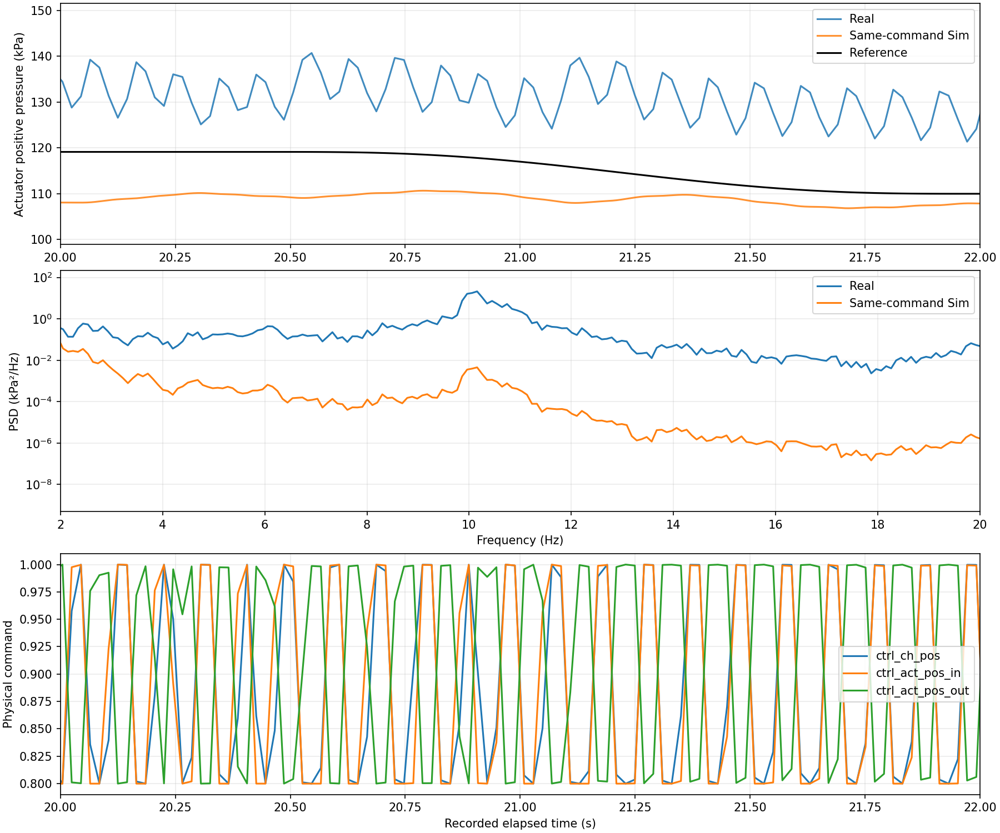

# Lib3 sim2real 초기화와 재학습 검토

2026년 10월 15일. 8월 31일 H/HR 정책의 실기 제로샷 결과에서 큰 오차가 확인됐다.
실제 운용은 펌프 상시 ON이다. 실기 재학습으로 바로 보정하기 전에 초기화와
관측 이력 불일치를 확인하고, 실제 운용을 반영한 시뮬레이션 재학습을 우선
검토한다. 초기화가 전체 오차의 원인이라는 결론은 아직 내리지 않는다.

## 대상과 확인된 결과

대상 모델은 `260831_lib3_histreward2x2_r025_H_smooth_seed0`와
`260831_lib3_histreward2x2_r025_HR_smooth_seed0`이다. 두 모델 모두 6채널 제어,
50Hz, 물리 명령 `0.8 + 0.2a`, PID OFF, predictor 없음으로 설정돼 있다.
H는 압력 및 action 이력을 사용하며 HR은 압력 변화율 관측을 추가한다.
학습 reference는 16개 압력 궤적 bank이며, 평가에는 동일한 0번 궤적을 사용한다.

기존 약 100초 반복 평가의 평균 절대오차는 다음과 같다. RMSE와 구분해야 한다.
시뮬레이션 값은 당시 저장된 체크포인트와 현재 로컬 시뮬레이터를 이용한 재실행
결과이며 학습 당시 평가 기록은 아니다.

| 모델 | 시뮬레이션 양압 / 음압 MAE | 실기 양압 / 음압 MAE |
|---|---|---|
| H | 10.59 / 3.76 kPa | 14.38 / 11.26 kPa |
| HR | 0.63 / 0.61 kPa | 73.33 / 28.58 kPa |

실기 기록 위치:

- H: `pneu_rl/exp/260831_lib3_histreward2x2_r025_H_smooth_seed0/261015_19_01_16_260831_lib3_histreward2x2_r025_H_smooth_seed0_Real/`
- HR: `pneu_rl/exp/260831_lib3_histreward2x2_r025_HR_smooth_seed0/261015_18_59_30_260831_lib3_histreward2x2_r025_HR_smooth_seed0_Real/`

기록의 첫 액추에이터 양압/음압은 H 약 201/101kPa, HR 약 114/91kPa로 서로
다르다. 첫 샘플은 실행 시작 부근의 값이지 명령 적용 전 동시 측정값은 아니다.
H에는 이전 실행의 압력이 남았을 가능성이 있다. 전부 개방 명령은 실제 개방이나
대기압 도달을 보증하지 않는다.

## 초기화 불일치

`env3.reset()`은 설정 초기 압력으로 압력 이력을 채운다. 두 모델은 대기압
101.325kPa를 사용한다. action 이력도 환경의 초기 action으로 채운다.
실기의 `real9.set_init_press()`는 Python 내부 상태를 설정할 뿐 장치를 물리적으로
대기압으로 초기화하지 않는다. 실제 장치 상태와 첫 정책 입력이 다를 수 있다.
HR의 유한차분 변화율은 초기 이력과 첫 실제 관측의 차이에도 영향을 받는다.

RL은 다양한 상태에서 동작할 수 있지만 학습 상태 분포 밖에서의 성능을 보장하지
않는다. 초기화는 가능한 원인 중 하나다. 실기 채널 순서, 밸브 명령 방향과 응답,
센서 보정, 물리 모델 차이, 시간 처리도 확인 대상이다. 실기 CSV의 일정한 20ms
간격은 timestamp fallback으로 만들어질 수 있으므로 실제 50Hz의 증거로 단정하지
않는다. 벽시계 시간과 센서 freshness를 별도로 계측해야 한다.

## 이미 수정한 실행 경로

- `real9`의 기본 스케일은 `0.8 + 0.2a`이며 모델 설정을 받는다.
- `quick_viz3`는 모델 bank 0번을 고정해서 처음 40초를 평가한다. 반복하지 않는다.
  40.96초 주기의 끝에서 대기압 시작점으로 점프하던 불연속을 평가에서 제외한다.
- 종료 시 PID와 스케일을 우회하여 물리 명령 6개를 1.0으로 한 번 기록한다.
  저장/그래프보다 먼저 실행하며 정상 종료, Ctrl+C, 오류 경로에 적용한다.
- TCP 브리지는 마지막 파일 명령을 계속 송신한다. 파일 기록 한 번과 네트워크
  송신 한 번은 다르며, 브리지가 종료되면 파일 기록만으로 장치 전달을 보장하지 않는다.
- `retrain3`는 모델 reference를 읽고 Real에서 별도 학습 프로세스를 사용한다.
  강제 action-delta/conflict 보상 및 temporal CAPS 덮어쓰기는 제거했다.

## 시도한 대기압 시작 진단 실험

이 절차는 상시 펌프 ON 운용의 성능 검증이 아니라 초기화 가설을 점검하는
보조 실험이다. 펌프 OFF 운용을 최종 표준으로 정한 것이 아니다.

1. 펌프를 OFF로 둔다. RT.vi와 TCP 브리지는 연결된 상태로 유지한다.
2. quick-viz에서 모델, REF 6, Real 2, PID OFF 2, 저장 1을 선택한다.
3. 모델 로딩 후 시작 대기 단계에서 6개 전체 개방 명령을 기록한다.
   실제 RT 센서의 압력 4개가 대기압 근처에서 안정되는지 수동 확인한다.
   브리지 시작 자체는 전체 개방을 보장하지 않는다.
4. 준비되면 펌프를 ON으로 전환하고 곧바로 Enter를 눌러 평가를 시작한다.
5. reference 시간 40초 후 전체 개방 명령이 기록된다. 펌프는 사용자가 OFF로 전환한다.
6. 비교할 다른 모델에도 같은 절차를 적용한다. 실제 초기 압력과 펌프 ON부터
   Enter까지의 간격을 기록한다. 40초 결과를 이전 100초 결과와 직접 동일시하지 않는다.

당시 추가했던 `quick_viz3`의 Real 시작 대기는 이 진단 절차를 안내했다. 코드가 펌프를
조작하거나 센서 압력 안정화를 자동 판정하지는 않는다. 준비 중 Ctrl+C를 누르면
정책 실행 없이 종료 개방 경로로 들어간다. 시작 절차 이름은 결과 cfg의 runtime에
저장된다. 현재 이력 초기화 자체는 아직 변경하지 않았다.

## 시뮬레이션 재학습 검토안

실제 상시 운용을 재현하려면 펌프 ON과 전체 개방 상태로 시뮬레이션을 먼저
진행한 뒤 얻은 압력 및 내부 상태에서 학습을 시작하는 방안을 검토한다.
전체 개방의 평형 압력이 반드시 대기압이라는 가정은 두지 않는다.
실제 평형 상태를 먼저 측정하고 모델이 이를 재현하는지 확인해야 한다.

한 평형점만 사용하기보다 여러 초기 압력, 부하 및 밸브 이력을 포함하고,
실제 연속 운전에서는 에피소드 경계에 관측/물리 상태를 보존하는 구성이 후보이다.
실기 정책 입력도 실제 센서와 적용 명령 이력으로 초기화해야 하며, 이력 수집 중
적용하는 명령과 수집 기간을 시뮬레이션과 맞춰야 한다.

판단 순서는 대기압 시작 진단, 상시 ON 조건과 초기 이력 정합성 확인,
명령/센서 매핑과 모델 응답 확인, sim 재학습, 동일 조건의 제로샷 재평가이다.
최종 평가는 학습에 쓰지 않은 궤적을 포함한다. 현재 기록만으로 sim 재학습이
모든 실기 오차를 해결한다고 결론내리지 않는다.

## 19시 17분과 18분 재측정 분석

새 그래프 4개와 원본 CSV를 확인했다. HR은 `261015_19_17_19`, H는
`261015_19_18_42` 결과다. H의 cfg에는 펌프 OFF 진단 프로토콜이 기록돼 있으나,
HR에는 해당 필드가 없어 동일 절차로 실행됐다고 파일만으로 단정할 수 없다.

| 항목 | HR | H |
|---|---|---|
| 첫 두 샘플 시간 | 0 → 12.722초 | 0 → 17.970초 |
| 첫 샘플 ref | 양압/음압 모두 0kPa | 양압/음압 모두 0kPa |
| 두 번째 샘플 ref | 약 101.325/101.325kPa | 약 101.325/101.325kPa |
| 전체 행 수 | 1,698 | 1,372 |
| 정상 구간 샘플 간격 중앙값 | 16.066ms | 16.077ms |
| 두 번째부터 마지막까지 기록 시간 | 27.284초 | 22.040초 |
| 20~40초 양압/음압 평균 | 125.08/80.57kPa | 124.49/80.46kPa |

그래프의 긴 초기 직선은 연속된 센서 기록이 아니다. 첫 두 점 사이에 샘플이
없는데 선으로 연결한 결과다. 목표를 0kPa부터 올리도록 설계한 것도 아니다.
시작 대기 중 전체 개방 관측이 첫 action의 응답으로 받아들여지고, 뒤늦게 도착한
현재 관측과 시간 원점이 섞이는 코드 경로가 이 현상과 부합한다.
`read_obs_file()`은 이전 time보다 증가했는지만 확인하며 현재 명령과 대응하는지
확인하지 않는다. Enter 대기를 추가할 때 시간/관측 경계를 분리하지 않은 결함이다.

따라서 이 결과는 온전한 40초 추종 평가로 사용할 수 없다. 초기 ref 0 샘플은
오차 계산에도 포함되며, 시작 대기만큼 reference 시간과 평가 종료가 앞당겨질 수
있다. 기존 파일은 원본으로 보존하고 재학습 성능 비교의 기준으로 삼지 않는다.

관측 간격 16ms는 `real_act.wait()`의 기본 4ms margin과도 일치한다. 실제 actuator
적용 시각은 별도 계측이 필요하지만, 최소한 이 기록은 20ms 주기와 같지 않다.
HR의 변화율 특징과 두 모델의 압력/action 이력 시간 범위가 학습과 달라진다.

한편 초기 구간을 제외해도 추종 실패는 남는다. 두 모델의 action 양상은 다른데
압력은 공통적으로 양압 약 125kPa, 음압 약 80kPa 부근에 머문다. 특히 HR의
양압 밸브 명령은 크게 진동해도 압력 변화는 작다. 이것은 단순 초기 압력 외에
실제 밸브 유효 범위, RT 명령 적용, 채널 대응, 유량/동역학 차이도 점검해야 할
근거다. CSV의 명령 필드는 실제 밸브 개방량이나 FPGA 적용 확인 신호가 아니다.

우선순위는 다음과 같다.

1. 시작 대기 관측을 제외하고 현재 명령에 대응하는 새 관측으로 시간 원점을 설정.
2. 실제 주기와 관측 age를 계측하고 50Hz 학습 조건에 맞춤.
3. 펌프 ON에서 전체 개방의 실제 정상 상태와 각 밸브 응답을 확인.
4. 같은 정상 상태를 시뮬레이션으로 재현하고 실제 이력으로 정책 초기 상태를 구성.
5. 그 주변 여러 초기 상태를 포함해 sim 재학습하고 미사용 ref로 실기 평가.

전체 개방 상태를 기점으로 한 sim 재학습은 실제 운용 조건에 맞는 후보지만,
통신/시간/명령 적용 문제가 해결되지 않은 상태에서 재학습만으로 해결된다고
판단하지 않는다. 이 절의 작업은 분석과 기록이며 해당 시간 동기화 수정이나
추가 장비 실험은 수행하지 않았다.


## 펌프 OFF 진단 절차 원복

2026년 10월 15일 사용자 요청에 따라 quick-viz의 펌프 OFF, 전체 개방,
펌프 ON 후 Enter 대기 절차를 제거했다. 정상 운용은 펌프 상시 ON이며,
모델과 reference 등을 선택한 뒤 바로 평가하는 흐름으로 복원했다.
시작 전에 자동으로 전체 개방하거나 안정화 시간을 기다리지는 않는다.
결과 cfg의 `runtime.start_protocol`은 `continuous_pump_on_no_start_wait`로 기록한다.

원복 이유는 펌프 OFF 시작이 실제 연속 운전과 다르고, 시작 대기를 평가 시간 및
새 관측과 분리하지 못해 앞서 기록한 긴 시간 점프를 유발하는 경로가 생겼기 때문이다.
대기압 시작 실험 결과는 초기화 효과만 분리해 입증한 결과로 사용할 수 없다.
기존 결과와 절차는 삭제하지 않고 실패한 진단 시도로 보존한다.

유지한 수정은 모델 bank 0번의 40초 무반복 평가, 모델 기반 스케일 설정,
종료 시 전부 개방 1회 기록, Real 비동기 재학습과 보상 덮어쓰기 제거이다.
이번 원복은 '전체 개방 상태에서 학습/초기화'를 구현한 것이 아니다.
실제 센서 이력 기반 초기화, 새 명령과 관측의 대응, 정확한 50Hz 제어는 여전히
별도로 해결해야 한다. 시작 대기 제거만으로 시간 동기화 문제가 모두 해결되지는 않는다.

검토 중인 다음 학습 방식은 펌프 ON·전체 개방으로 충분히 진행하여 얻은
압력·밸브 내부 상태·관측 이력을 시뮬레이션 초기 상태로 사용하는 것이다.
실기의 동일 조건에서 측정한 정상 상태와 밸브 응답을 먼저 비교하고,
여러 초기 상태를 포함한 sim 재학습의 효과를 검증해야 한다.

## 2026-10-16 후속 검증과 다음 실물 테스트

사용자 결정: 전체 개방 조건으로 학습한 모델의 실물 결과도 확인한다.
이번 테스트 대상은 **새 HR 2000 episode**
`261015_lib3_allopen30_HR_smooth_seed0`이다. 기존 HR 2000이나 기존 HR에서
20 episode 이어 학습한 모델과 구분한다. Sim 최상 성능 모델이라고 단정해서 고른 것이
아니라, 완료한 초기화 변경 학습이 실제 운용에서 어떤 결과를 내는지 확인하는 비교 실험이다.

### 지금까지 확인한 결과

- H/HR 모두 전체 개방 준비 상태에서 새로 2000 episode 학습했다.
  16개 학습 ref의 통합 RMSE는 H 4.165, HR 2.694 kPa였다.
  H는 공급 음압 설정 하한 이탈이 있어 이번 실물 업로드 대상에서 제외한다.
- 새 HR의 시작 ref를 전체 개방 actuator 압력에서 2초/5초 동안 연결하면 초기 오차는
  줄지만 지속 음압 오프셋은 남았다. 원래 ref를 사용한 긴 고정 목표 실험에서
  기존 HR의 음압 bias는 +0.168, 새 HR2000은 +1.881 kPa였다.
- 기존 HR에서 20 episode 이어 학습한 별도 실험은 16개 ref RMSE가
  2.103→2.080 kPa로 대체로 유지됐지만 명령 변화량은 약 26% 증가했다.
  전체 개방 초기화 자체가 큰 오프셋을 반드시 만드는 것은 아니며, 새 학습의 경로와
  최종 정책 차이가 관련됐을 가능성이 있다. 원인을 확정한 것은 아니다.
- 이러한 결과는 Sim 안에서의 분석이다. 실물 실패 원인이나 실물 개선 여부는 아직 확인되지 않았다.

상세 기록:

- [전체 개방 학습 결과](lib3_all_open_training_review_20261016.md)
- [ref 시작 연결 및 HR 음압 bias](lib3_reference_start_and_hr_bias_20261016.md)
- [기존 HR의 짧은 추가 학습](lib3_hr_short_finetune_20261016.md)

### 먼저 수행할 zero-shot 테스트

1. 새 HR2000을 사용하고 정책 업데이트는 끈다. PID OFF, 기존 모델 bank0의
   40초 무반복 ref로 시작한다. 이번에는 연결 ref까지 동시에 바꾸지 않는다.
2. 펌프 상시 ON 운용을 유지한다. 정책 적용 전 실제 압력 4개와 실제 적용 명령을
   기록하고, reference 시간 원점과 센서 timestamp를 구분한다.
3. 현재 quick_viz의 **Sim 경로**는 준비 운전과 history를 보존하지만 **Real 경로의
   실측 history 초기화는 아직 구현/검증이 완료된 것이 아니다**. 첫 상태가 실제 센서
   이력인지, 가상 대기압 이력인지 반드시 기록한다. 미정합 상태에서 실행한 결과는
   실물 진단 데이터로 남기되 초기화 학습의 효과만을 분리한 평가라고 주장하지 않는다.
4. 센서 freshness, 실제 관측 간격과 명령 적용 대응을 확인한다. 과거 약 16ms 간격과
   reference 시작 시각 문제가 새 모델을 올리는 것만으로 해결되지는 않는다.
5. 네 압력, ref, 여섯 밸브 명령, timestamp, 모델/체크포인트, 시작 protocol을 저장한다.
   전체 오차와 초기 구간/이후 구간을 나눠 보고, 음압 bias와 공급 챔버 압력도 함께 비교한다.
6. 예전 HR도 같은 실행 경로와 ref에서 비교 기준으로 유지한다. 서로 다른 시작 압력이나
   시계 조건에서 얻은 차이를 모델 성능 차이라고 단정하지 않는다.

### 데이터가 오래됐고 수집 회차마다 달라지는 문제

현재 simulator는 약 3개월 전 실물 데이터에 기반한 튜닝이라는 사용자 설명이 있다.
최신 데이터 한 번에 다시 맞추는 것보다 **한 회차로 보정한 모델이 다른 회차도 설명하는지**가
중요하다. 바로 전체 재튜닝·처음부터 재학습을 반복하기보다 다음 순서로 진행한다.

1. 실행 경로의 단위/채널/시계/history를 확인한다. 통신 지연이나 가짜 초기 이력을
   물리 파라미터로 보정하지 않도록 물리 불일치와 실행 문제를 구분한다.
2. lib3에서 펌프 ON·전체 개방 시작, 동일한 짧은 밸브 입력 순서를 반복하여
   전체 개방 평형, 상승/하강, 유지 응답 데이터를 확보한다. 적용 조건과 회차를 함께 저장한다.
   가능한 경우 이미 검증된 운전 범위의 입력을 사용하며 구체적 명령 순서는 별도로 확정한다.
3. 실물의 같은 명령을 현재 Sim에 재생한다. 반복끼리는 비슷하지만 Sim만 다르면
   모델 재보정 후보, 반복끼리도 다르면 상태/시간 변화와 변동 범위의 모델링 후보로 본다.
4. 누설과 펌프 계수가 함께 튜닝되는 구조를 고려한다. 압력 기록만으로 누설 하나를
   원인으로 단정하지 않고, 함께 보정한 파라미터 조합도 별도 수집 회차에서 검증한다.
5. 튜닝용 데이터와 검증용 회차를 분리한다. 보정된 Sim에서 기존 HR을 먼저 고정 평가하고,
   필요할 때만 짧은 이어 학습 또는 변동 조건을 포함한 학습을 검토한다.
6. 실물 데이터로 simulator를 식별하고 정책을 Sim에서 학습했다면, 실물 정책 업데이트가
   없는 배포와 실물 데이터 자체가 없는 전이를 구분해서 기술한다.

이번 문서 추가는 후속 실험 계획 기록이다. 실물 데이터 수집, 파라미터 재보정,
새 실물 zero-shot은 아직 수행하지 않았다.

### HR2000 전달 패키지

`pneu_rl/model_archives/lib3_sim2real_HR_allopen30_epi2000_20261016.zip`에는
새 HR의 `model_epi_2000.pth`를 실행용 `model.pth` 이름으로 **한 번만** 넣는다.
동일 cfg와 실행에 필요한 reference bank, 출처/hash 안내를 함께 넣는다.
H, 500/1000/1500 체크포인트, +20 이어 학습 모델, replay는 포함하지 않는다.
기존 파일을 덮어쓰지 않도록 새 모델 폴더 이름을 유지한다. Real PC에는
최근 quick_viz3 및 관련 환경 코드도 별도로 반영되어 있어야 한다.

Google Drive 업로드 완료(2026-10-16):
[HR 전체 개방 학습 2000 episode ZIP](https://drive.google.com/file/d/1OLFMQ2QnwMyA5TFoTJO32Ezw-GVwiSn2/view?usp=drivesdk).
내 Drive 루트에 저장했으며, 업로드 후 파일명/ID와 크기 2,702,048 bytes를 다시 조회해 확인했다.
로컬 ZIP 검사는 통과했고 포함된 가중치가 원본 2000 체크포인트와 같은 SHA256임을 검증했다.
ZIP SHA256: `2c64c42916307efae992552af2dac02a28769a47827e652b472e4cd838254293`.

## 실물 PC 복귀 To-do — 2026-10-16

**이번 목표는 새 전체 개방 학습 HR2000의 실제 zero-shot 결과를 기록하는 것이다.**
먼저 한 번의 진단 실행을 하고 로그의 시간/history 정합성을 판정한다.
현재 코드의 Real history 초기화·관측 타이밍 한계가 있으므로, 실행 결과를 곧바로
“초기화 변경 학습의 공정한 성능 비교”로 해석하지 않는다.

### A. 코드와 모델 준비

- [ ] 실물 PC의 변경 사항부터 확인하고 최신 코드 받기. 로컬 수정이 있으면 보존하고
  충돌 내용을 확인한다. `reset --hard` 등으로 삭제하지 않는다.

```bash
cd <실물-PC의-brl_window_v2>
git status --short
git pull --ff-only origin main
git rev-parse HEAD
```

- [ ] [새 HR2000 ZIP](https://drive.google.com/file/d/1OLFMQ2QnwMyA5TFoTJO32Ezw-GVwiSn2/view?usp=drivesdk)을
  내려받아 **저장소 루트**에 풀기. ZIP 내부에 `pneu_rl/models/...` 경로가 이미 있다.
  가중치는 2000 episode 한 개이며 실행 파일명은 `model.pth`다.
- [ ] 선택할 모델 폴더가 **`261015_lib3_allopen30_HR_smooth_seed0`**인지 확인.
  기존 8월 HR 및 `261016_lib3_oldHR_allopen_short20_seed0`과 혼동하지 않는다.
- [ ] ZIP SHA256 확인:
  `2c64c42916307efae992552af2dac02a28769a47827e652b472e4cd838254293`.

Linux/bash 예시(다운로드 위치가 다르면 경로 수정):

```bash
sha256sum ~/Downloads/lib3_sim2real_HR_allopen30_epi2000_20261016.zip
unzip -n ~/Downloads/lib3_sim2real_HR_allopen30_epi2000_20261016.zip -d .
```

`-n`은 기존 파일을 덮어쓰지 않는다. 이미 같은 모델 폴더가 있다면 ZIP의
`manifest.json`에 적힌 SHA256과 실행 파일을 비교하여 오래된 파일을 사용하지 않도록 한다.
실행 코드는 ZIP에 없고 Git에서 가져온다.

### B. 실행 전 기록

- [ ] 기존에 사용하던 Python/ROS 실행 환경을 활성화하고 저장소 루트에서
  `source activate_env.sh` 실행. 이 스크립트는 PYTHONPATH 설정용이며 conda 환경을 활성화하지 않는다.
- [ ] 기존 RT.vi/FPGA 및 TCP bridge가 정상적으로 연결되어 새 센서 데이터가 들어오는지 확인.
  이번 코드가 bridge나 펌프를 자동으로 켜는 것은 아니다.
- [ ] 펌프 상시 ON 운용 유지. 실제 전체 개방 상태, 시작 직전 네 압력,
  직전 실행과의 간격을 기록. Sim 평형 압력과 실제 압력이 같다고 가정하지 않는다.
- [ ] 사용한 Git commit, 모델 이름, 원본 checkpoint=2000, 날짜/시간 기록.
- [ ] 학습/재학습 프로세스를 동시에 실행하지 않는다. 이번에는 `retrain3.py`를 실행하지 않는다.

### C. 짧은 zero-shot 실행

```bash
source activate_env.sh
python pneu_rl/scripts/quick_viz3.py
```

대화형 선택:

| 항목 | 선택 |
|---|---|
| MODEL | `261015_lib3_allopen30_HR_smooth_seed0`의 표시 번호 |
| REF | `6` 또는 Enter: model bank0, 40초, 반복 없음 |
| OBS | `2`: Real |
| PID | `2`: OFF |
| Logging | `1`: 저장 |

- [ ] 기존 ref를 그대로 사용. 2초/5초 시작 연결은 아직 기본 실행에 적용하지 않는다.
- [ ] 첫 실행은 진단으로 취급하며 실제 wall-clock 시작·종료 시각도 기록한다.
- [ ] 정상 종료/중단 후 명령 파일의 전체 개방 명령이 bridge를 통해 실제 적용됐는지 확인.
  스크립트 종료 명령은 펌프 OFF가 아니다.

### D. 실행 직후 체크와 가져올 파일

- [ ] 결과 폴더 `pneu_rl/exp/261015_lib3_allopen30_HR_smooth_seed0/<실행이름>/` 보존.
  CSV, `cfg.yaml`, 생성된 그래프를 함께 가져온다. 그래프만 가져오지 않는다.
- [ ] 첫 행 ref=0 placeholder, 시작의 긴 timestamp 점프, 센서 값 반복/누락이 있는지 확인.
- [ ] 유효 로그의 실제 구간이 40초인지, 관측 간격이 약 20ms인지 확인.
  16ms면 획득·제어 주기 불일치로 기록한다. 약 2000행은 참고일 뿐 시간 정합성의 증명은 아니다.
- [ ] Real CSV `curr_time`은 센서 측 시각이다. 준비 Sim처럼 정책 경과 시간으로
  바뀌었다고 가정하지 않는다. 현재 Real의 `reference_time`은 미기록(NaN)일 수 있으며,
  이 경우 정책 ref 조회 시각이 확인됐다고 주장하지 않는다.
- [ ] 압력 네 채널의 단위/순서, 물리 밸브 명령 0.8~1.0, PID OFF와 runtime 설정 확인.
- [ ] 양/음압 전체 RMSE, 초기 구간, 이후 bias, 공급 챔버 압력, 명령 포화·진동을 나눠 본다.
- [ ] Drive에 결과 폴더를 올린 뒤 이 분석 PC에서 해당 CSV와 cfg를 받아 비교한다.
  가능하면 기존 HR도 같은 실행 경로에서 별도 반복해 기준으로 남긴다.

### E. 결과에 따른 다음 작업

- 시간/history/명령 대응 문제 → 실행 경로를 먼저 수정하고 재측정.
- 실행 정합성이 확보돼도 큰 gap → 같은 짧은 입력의 반복 데이터 수집 후 Sim 재생 비교.
- 반복 회차는 비슷한데 Sim만 다름 → 펌프·누설의 결합을 고려한 재보정과 별도 회차 검증.
- 회차마다 실물 응답도 다름 → 변화 조건과 범위를 기록하고 강건 학습/짧은 적응 필요성 판단.
- 재보정 후에도 우선 기존 정책을 고정 평가. 바로 처음부터 2000 episode 재학습하지 않는다.

연구 해석에서는 초기 상태 변화, ref 변화, 동역학 변화, 식별 데이터 밖 명령 패턴을
구분한다. 모든 실패를 OOD라는 이름으로 원인 규명 없이 묶지 않는다.
RL 피드백이 어느 정도 mismatch에서 회복하는지는 고정 정책의 별도 검증 대상으로 남긴다.


## 2026-10-16 16:15 실행: 학습–실기 연결 감사

실기 추가 실행이나 정책 수정 없이 학습 코드, quick_viz3 → env3 → real9 →
real_act → TCP의 순서 및 Sim의 C++ 채널을 확인했다. IDE의 retrain4_hz_test는
lib4/env4/real4 경로이며 이번 lib3 quick_viz3 평가에는 사용되지 않는다.

- 새 HR cfg는 50Hz, 관측 지연 0.1초, noise=False, normalized action 0~1,
  physical scale 0.8~1, pressure rate feature, action history 10개다.
- quick-viz는 선택 폴더의 model.pth와 cfg를 읽고 deterministic mean action을 쓴다.
  저장 cfg에서 PID OFF, bank0, standard_env_reset을 확인했다. 평가 중 업데이트는 없다.
- 실 backend observe까지 파일 I/O를 mock하여 108개 입력(0, 1, 각 채널 단독,
  난수)을 검사했다. 최종 명령은 0.8+0.2a와 최대 오차 1.11e-16으로 일치한다.
  Python의 이중 스케일 오류/채널 재배열은 발견하지 못했다.
- Sim C++ / Python / TCP의 순서는 공급 양압, 공급 음압, actuator 양압 in/out,
  actuator 음압 in/out이다. 특히 음압 in은 ATM→actuator, out은 actuator→진공 챔버다.
  RT.vi/FPGA 소스가 저장소에 없어 실제 하드웨어 매핑까지 검증한 것은 아니다.
- Sim은 6칸 버퍼로 압력 관측을 5 step(100ms) 지연한다. Real9는 delay 인자를
  **kwargs로 받아 사용하지 않는다. 따라서 설정 파일을 같게 읽어도 지연은 같지 않다.
  네트워크 RTT는 물리 센서의 샘플 나이와 같지 않다. time_ctrl_sent는 Python 브리지가
  붙인 값으로 FPGA의 명령 적용/센서 샘플 동기화를 증명하지 않는다.
- 학습 reset은 30초 전체 개방 물리 상태 및 실제 Sim history를 보존한다. Real은
  대기압 pressure history와 action_low history로 reset한다. 수동 준비로 해결되지 않는다.
- HR의 rate는 인접 관측 차이×50이며 별도 필터가 없다. 학습 noise=False이고
  CAPS/명령 변화 penalty는 0이다. 이는 진동 가능성에 관련된 조건이지 단독 원인 증명이 아니다.
- 앞선 주기 수정에서 명령 후 관측 대기를 주기 시작 대기로 옮겼으므로
  샘플링 위상도 변경됐다. 이번 성능 변화를 주파수 하나의 효과로 해석하면 안 된다.

### 지연만 바꾼 Sim 대조 실험

같은 새 HR model.pth, bank0, 30초 전체 개방 초기화, 40초 frozen 평가를 사용했다.
noise=False이며 동역학/가중치/목표는 그대로 두고 obs.delay만 바꿨다.
아래 지표는 기록상 6초 이후이며 단일 bank 결과다.

| 관측 지연 | 양압 RMSE kPa | 음압 RMSE kPa | 6채널 평균 절대 명령 step 변화 |
|---|---:|---:|---:|
| 100ms (학습 설정) | 0.736 | 2.816 | 0.00421 |
| 0ms | 3.601 | 1.160 | 0.03837 |
| 20ms | 4.042 | 1.488 | 0.03834 |

지연 불일치만으로도 명령 변화가 약 9배 증가했다. 이는 관측/명령 history의 시간 관계가
중요하다는 대조 근거다. Real의 전체 오차 또는 약 10Hz 진동을 완전히 설명한 것은 아니다.
실제 센서 지연을 모른 채 Real에 100ms를 무조건 더하는 처방은 하지 않았다.

실기 16:15 결과는 평균 49.78Hz, 최대 간격 23.99ms, 40.012초다.
양압 및 양압 밸브 명령에 약 10.1Hz 성분이 함께 보인다. 전체 개방 로그에서도
Sim 대비 actuator 음압 약 +10.55kPa 차이가 있으므로 물리 모델 차이도 남아 있다.

산출물: `docs/img/lib3_real_zeroshot_20261016/delay_audit_*.csv`와
`audit_hr_path.py`(Sim 및 mock I/O만 실행). 다음 순서는 원시 sample 시각/명령 적용
관계 확인, 실측 초기 history, 관측 지연 정합성의 통제 비교다. 제어 필터나 reward를
즉시 변경하여 원인을 섞지 않는다.


## 2026-10-16 동일 명령 재생으로 추가 지연 판단

실기 `261016_16_15_14`의 6개 물리 명령(0.8~1.0)을 현재 lib3 .so에
scale=False, noise=False, delay=0으로 재생했다. 정책은 실행하지 않았다.
명령을 1ms 격자에서 zero-order hold하여 실제 기록 간격을 보존했다
(전환 시각 양자화 <1ms). 20ms 한 번과 1ms 20번 적분의 2초 일정 명령
검사에서 마지막 압력 4개의 최대 차이는 0이었다.

초기화는 (a) Sim 전체 개방 30초, (b) 실기 첫 행 압력 4개로 reset 두 가지다.
(b)는 압력만 맞추고 숨은 펌프/밸브 상태까지 식별한 것은 아니다.
현재 로드한 .so에는 소스에 있는 augmented-state export가 없어서 임의로
바이너리를 재빌드하거나 숨은 상태를 직접 덮어쓰지 않았다. 소스와 바이너리의
전체 일치도는 별도 확인 대상이며, 이번 분석은 현 로컬 학습/evaluation 경로의
실제 로드 바이너리를 사용했다. CSV와 .so SHA256은 audit.json에 남겼다.

20~38초 평균 압력(kPa), 실측 압력 reset 재생:

| 채널 | Real | 동일 명령 Sim |
|---|---:|---:|
| 공급 양압 | 191.46 | 125.35 |
| 공급 음압 | 31.42 | 14.05 |
| actuator 양압 | 130.86 | 109.33 |
| actuator 음압 | 80.35 | 41.11 |

양압 약 10Hz 진동은 Sim에서 같은 크기로 재현되지 않는다. 두 초기화의
후반 응답은 서로 가까워지지만 실기와의 큰 압력 차이는 남는다.

시차 스캔은 Real(t) 대 Sim(t-lag), -300~+300ms, 2ms 간격이다.
1.02초 centered moving average를 뺀 신호의 상관을 사용하고, 모든 lag에
동일한 비교 샘플을 적용했다. 6~20초/20~38초를 별도로 검사했다.
전체 6~38초 최고 상관 lag는 공급 양압 -142ms(r=.35), 공급 음압
-134ms(r=.55), actuator 양압 -138ms(r=.30), actuator 음압 +18ms(r=.88)다.
음압 actuator는 앞/뒤 구간 +28/+10ms로 달라진다. 이는 물리 transport delay
식별값이 아니라 관측 파형을 맞춘 겉보기 시차다. 양압은 상관이 낮고 약 100ms
주기성 때문에 여러 봉우리가 있어 -138ms를 실제 선행/지연으로 해석하지 않는다.

관측 지연 100ms를 Sim 출력에 추가해도 6~38초 actuator 양압/음압 RMSE는
21.16/39.35 → 21.15/39.33 kPa 수준으로 거의 그대로다. 이는 시간 이동만으로
큰 응답 차이가 없어지지 않음을 뜻한다. Real 입력을 늦췄을 때 새 정책의
폐루프 성능을 시험한 것은 아니므로 그 효과까지 부정하는 근거로 쓰지 않는다.

결론: 현재 자료로 추가 지연 하나를 채택할 근거가 없다. 명령의 실제 적용과
물리 응답 크기/운전점, 밸브 모델 차이를 분리해야 한다. EXP는 RT 센서 시각과
원래 policy 명령/적용 echo를 모두 남기지 않으므로 정확한 명령→센서 지연은
확정할 수 없다. 다음 식별 실험은 원시 센서 시각·송수신 시각·정책 명령·RT 적용
명령을 함께 기록하고, 전체 개방 기준에서 한 채널씩 작은 비주기 입력을 주는
방식이 적절하다. 이번 작업에서는 장치를 실행하거나 제어 지연을 변경하지 않았다.

재현 코드: `pneu_rl/scripts/analyze_lib3_real_delay.py`.
산출물: `docs/img/lib3_command_replay_20261016/`의 replay.png, lag_scan.png,
lag_summary.csv, lag_curves.csv, 초기화별 재생 CSV, audit.json.


## 2026-10-16 결과 모음 및 공유

새 문서를 만들지 않고 이 문서에 결과를 통합한다. RMSE 단위는 kPa이며 전체
EXP 샘플 기준이다. 앞의 두 실행은 기록 40초/실제 명령 약 32.23초였고,
마지막 실행은 주기 및 현재 명령 응답 확인을 수정한 뒤의 결과다.

| 실행 | 정책 | 양압 RMSE | 음압 RMSE | 시간 조건 |
|---|---|---:|---:|---|
| 15:56:56 | 새 allopen30 HR | 9.96 | 17.46 | 실제 약 62Hz, EXP 시간 왜곡 |
| 15:57:57 | 기존 0831 HR | 82.96 | 30.93 | 실제 약 62Hz, EXP 시간 왜곡 |
| 16:15:14 | 새 allopen30 HR | 16.25 | 13.73 | 약 49.78Hz, 40.012초 |

16:13 전체 개방 기록은 60.018초/2986행, 명령 평균 49.744Hz,
간격 중앙값 20.087ms/최대 20.555ms다. 마지막 10초 평균 공급 양/음압은
154.905/47.874, actuator 양/음압은 124.021/87.319이다. 느린 drift는 남는다.
6채널 명령은 모두 1이며 command timestamp가 반환된 값과 일치했다.
이는 RT 센서의 실제 샘플 시각/밸브 적용 시각까지 증명하지는 않는다.

사용자가 첨부한 100초 그림의 음압은 목표와 유사한 개형을 보이지만 offset과
진폭 차이가 남고 양압은 대기압 근처에 머문다. 그림만으로 모델/실행 식별을
확정하지 않는다. 40초 그림은 기존 HR 15:57 기록과 일치하는 형태로, 이를
새 모델 결과로 혼동하면 안 된다. 명령이 매끄러워도 추종이 좋다는 뜻은 아니다.
현재 근거로 새 모델이 모든 면에서 더 나쁘다거나 전체 개방 학습 자체가
실패 원인이라고 결론내리지 않는다. 평가 조건도 서로 달랐다.

- [Quick-viz 3회 및 분석 산출물 ZIP (Drive)](https://drive.google.com/file/d/1QyAtjBTOJ98QQVYR70zDKH6uTYXMFW32/view)
- [실기 비교 그래프](img/lib3_real_zeroshot_20261016/comparison.png)
- [16:15 진동 확대](img/lib3_real_zeroshot_20261016/vibration_161514.png)
- [동일 명령 재생](img/lib3_command_replay_20261016/replay.png)
- [시차 스캔](img/lib3_command_replay_20261016/lag_scan.png)

Drive ZIP은 오늘 Quick-viz 원본 CSV/그림/cfg와 분석 산출물 27개를 포함한다.
TCP/IP 원본 CSV는 포함하지 않았으며 로컬에 보존한다. Git에는 코드·기존 문서·
분석 산출물을 포함하고 exp 및 TCP/IP CSV는 제외한다.

## 2026-10-16 후속 재분석: 양압 진동과 지속 편차를 분리

실물 PC의 `8e56f8f` 반영 뒤 EXP 3개를 다시 읽고, 위 동일 명령 Sim 재생 CSV를
독립적으로 집계했다. 실물 실행·재학습·제어 코드 변경은 하지 않았다. 재생 Sim을
이번에 새로 실행한 것은 아니다. 16:15 원본 SHA256은 기존 audit.json과 일치한다.

### Hz 수정 뒤 무엇이 나빠졌나

같은 새 HR의 **기록 시간 6~38초**를 비교한다. 수정 전 시간은 nominal step
시간이므로 동일 물리 시간/동일 ref 진행 속도의 통제 비교는 아니다.
편차는 측정−목표이며, `RMSE² = 평균 편차² + 오차 표준편차²`로 분해했다.
표준편차는 느린 추종 오차도 포함하므로 순수 진동 크기와 같지 않다.

| 새 HR 실행 | 양압 RMSE | 양압 평균 편차 | 양압 오차 표준편차 | 음압 RMSE |
|---|---:|---:|---:|---:|
| 15:56 주기 수정 전 | 10.45 | +9.44 | 4.49 | 18.17 |
| 16:15 주기 수정 후 | 16.33 | +15.64 | 4.70 | 14.16 |

단위는 kPa. **양압 악화는 진동 증가만으로 설명되지 않고 지속적인 양의 편차
증가가 크게 기여한다. 음압은 오히려 개선됐다.** 전체 구간 RMSE도 양압
9.96→16.25, 음압 17.46→13.73이다. 주기 수정은 관측 순서/샘플링 위상도
바꿨고 시작 압력도 달라서, 이 비교를 Hz의 인과 효과라고 해석하지 않는다.

### 양압 진동은 로그와 동일 명령 Sim에서 얼마나 다른가

16:15 로그의 기록 간격은 평균 49.785Hz, 최대 23.994ms다. 기록 6~38초를
50Hz 균일 격자로 보간하고 Welch PSD(nperseg=512)를 계산했다.

- 양압 압력과 공급 양압/act 양압 in/out 명령 모두 2~20Hz 대역 최대 봉우리가
  **10.16Hz**다. 명령은 물리 범위 0.8~1.0 양 끝을 반복해서 오간다.
- 양압의 8~12Hz 대역 RMS는 **Real 3.510kPa, 동일 명령 Sim 0.050kPa**다.
  이는 해당 로그의 대역 에너지 차이이며 식별된 전달함수 gain이나 폐루프
  안정성 증명은 아니다. 명령–압력이 함께 진동한다는 사실만으로 인과 방향을
  결정할 수도 없다. 물리 센서 시각이 없으므로 aliasing 가능성도 남는다.
- 20~38초 평균은 Real/Sim 각각 공급 양압 **191.46/125.35**, act 양압
  **130.86/109.33**, act 음압 **80.35/41.11kPa**다. 기록된 동일 명령에 대해
  빠른 성분뿐 아니라 운전점 자체도 다르다.
- Sim 초기화를 전체 개방 준비 상태에서 실측 초기 압력으로 바꿔도 후반 평균
  act 양압은 **109.28→109.33kPa**, act 음압은 둘 다 **41.11kPa**다.
  이 재생에서는 초기 압력 네 값만 맞추는 것으로 후반 격차가 해소되지 않는다.



### 현재 가능한 판단과 아직 불가능한 판단

**현재 Sim과 배포 경로 사이에 큰 입력–출력 불일치가 있다는 근거는 강하다.**
단순히 zero-shot 점수가 낮다는 것보다 동일 명령 재생과 운전점 비교가 직접적인
근거다. 다만 그 원인을 누설/펌프 파라미터 등 물리 동역학 하나로 확정하지 않는다.
실제 밸브 적용 명령/시각, 센서 샘플 나이, RT 채널 매핑은 완전히 검증되지 않았다.
기록 명령이 실제 적용 명령이라는 재생의 전제가 틀리면 해석도 달라진다.

앞 절의 Sim 지연 대조는 학습 100ms에서 0/20ms로 바꿀 때 명령 변화가 약 9배
증가함을 보여준다. 따라서 **시간 관계에 민감한 정책과 실물의 응답 불일치가
함께 진동을 만들었다는 가설**이 합리적이다. 하지만 실제 센서 지연을 측정하지
않았으므로 실물에 100ms를 더하면 해결된다는 결론은 아니다.

초기 history 불일치는 별도로 고쳐야 하는 배포 문제다. 다만 이번 후반 구간의
격차까지 history만으로 설명할 근거는 없다. HR의 rate 입력이 진동을 증폭했는지도
아직 가설이며, H와 동일 조건 실험 없이 HR 구조 자체를 원인으로 확정하지 않는다.

### 다음 실물 확인 순서

1. **정책 출력→송신→RT 실제 적용→센서 샘플의 기록 연결부터 확인한다.**
   현재 EXP의 sensor_time 이름만으로 물리 센서 시각이라고 간주하지 않는다.
   policy 원명령, 반환 명령, bridge 송수신 시각, RT 원시 시각을 함께 남기고,
   RT가 실제 적용 시각/명령을 제공하는지 확인한다. 로컬 TCP history 두 CSV는
   수정 시각이 7월 3일이고 이번 10월 실행과 연결되지 않아 이번 증거로 쓰지 않았다.
2. **전체 개방 고정 명령에서 압력 리플을 먼저 기록한다.** 이어 이미 확인된
   운전 범위 안에서 한 채널씩 작은 비주기 명령을 주고, 동일 명령 Sim과
   정상 압력·변화 방향·응답 크기·응답 시간을 비교한다. 명령 고정 중에도 10Hz
   성분이 있으면 펌프/측정 경로의 주기 성분 가능성을 우선 검토한다. 정책 때만
   크면 폐루프 상호작용 가설이 강해진다. 운전점에 따른 차이도 함께 고려한다.
3. **배포 시간/history 정합성을 먼저 통제한 뒤 같은 HR을 짧게 재평가한다.**
   양압 평균 편차와 8~12Hz 진동을 별도 지표로 본다. 이때도 고정 명령 응답이
   Sim과 다르면 해당 조건의 데이터를 튜닝에 사용하고, 별도 명령으로 검증한다.
   원인 분리 전에 지연·필터·reward·누설 계수를 한꺼번에 변경하지 않는다.

재현: `MPLCONFIGDIR=/tmp/brl_review_mpl /home/rise/miniconda3/envs/env_1/bin/python
pneu_rl/scripts/review_lib3_zeroshot_oscillation.py` (저장소 루트에서 한 줄로 실행).
산출물은 `docs/img/lib3_zeroshot_review_20261016/`의 tracking.csv, spectra.csv,
replay_means.csv, summary.json, 위 그림이다. 원본 경로·해시 및 분석 한계를
summary.json에 기록했다.

## 2026-10-18 과거 lib3 수집·튜닝·정확도·밸브 feasibility 감사

### 원본 위치와 현재 소스의 계보

별도 작업 폴더 `/home/rise/test/pneu_tune`에 원본 CSV, valve fit, 펌프 튜닝,
검증 그림이 보존돼 있다. 이 폴더는 읽기만 했다.

- 현재 `pneu_env/src/pneu_env/lib3/pneumatic_CT.cpp`의 **6개 밸브, 각 13개
  파라미터가 `pneu_tune/tune_result/output_12.txt`와 모두 일치**한다.
- output_12의 데이터는 `260520_14_44_14_Flowrate_RND6_suite_joint_tuning.csv`.
  전체 구간, 입력/유량 window=1, flow delay=0 설정이다.
- 현재 `lib3/pneumatic_simulator.h`의 CIN_=3.6198491, COUT_=7.49941545는
  `exp/coeff_result/260527_19_05_21_discharge_coeff_lib3/coeff.yaml`과 반올림
  수준에서 일치한다. 그 cfg 역시 **5월 20일 데이터**를 사용한다.
- 따라서 현재 소스로 확인되는 계보는 '약 3개월 전'보다 오래된 **5월 데이터**다.
  10월 18일 기준 약 5개월이다. 이는 과거 학습 당시 로드한 .so까지 동일하다는
  증명은 아니며, 보존된 replay의 바이너리/파라미터 버전도 고정돼 있지 않다.

### 수집 시간: 약 10분이라는 기억과 실제 파일

원본 CSV의 마지막−첫 timestamp로 계산했다. 독립적인 벽시계 기록 검증은 아니다.

| 날짜·실험 | 기록 길이 | 의미 |
|---|---:|---|
| 05-20 14:44 joint_tuning | 722초 / 12.03분 | 현재 소스와 연결되는 valve/pump 튜닝 데이터 |
| 05-21 17:21 joint_tuning | 797초 / 13.28분 | 별도 수집·펌프 튜닝 결과 및 replay 존재 |
| 05-27 17:01 joint_tuning | 984초 / 16.40분 | 별도 원본; 같은 날 튜닝 cfg는 이 파일이 아닌 05-20 파일을 지정 |
| 06-15 16:26 joint_id_10min | 582초 / 9.70분 | 10분 수집 계열 |
| 06-15 19:30 joint_id_10min | 588초 / 9.80분 | 10분 수집 계열 |
| 06-16 12:58 joint_id_10min | 588초 / 9.80분 | tuner4의 pump/leak/l_init 공동 튜닝 cfg에 등장 |
| 06-17 13:14 fixed_vol_output12traj | 984초 / 16.40분 | fixed-volume 명시 원본 |

즉 10분 기록은 실제로 있다. 다만 현재 lib3 소스의 직접 근거는 12분 데이터이며,
10분 tuner4 계열 결과를 현재 lib3 calibration으로 혼동하면 안 된다.

### 당시 Model Acc가 좋았나

output_12.png의 **튜닝 데이터에 대한 밸브 유량 fit**:

| 채널 | 유량 RMSE (L/min) | R² |
|---|---:|---:|
| 공급 양압→ATM | 1.8034 | 88.7% |
| ATM→공급 음압 | 1.6117 | 86.9% |
| 공급 양압→act 양압 | 1.7519 | 83.3% |
| act 양압→ATM | 1.4839 | 88.0% |
| ATM→act 음압 | 1.0672 | 91.2% |
| act 음압→공급 음압 | 1.0765 | 91.2% |

유량 형태를 상당 부분 설명한다는 기억은 근거가 있다. 그러나 이는 동일 데이터
fit이며, 모델 전체의 독립 검증 통과나 현재 시스템 정확도를 뜻하지 않는다.
그림의 HF ratio는 약 1.85~2.27이다. 코드상 이는 `std(diff(pred))/std(diff(real))`로,
특정 주파수 대역의 전달함수 gain이 아니다. 빠른 변화까지 완벽히 맞았다는 근거도 아니다.

저장된 05-20/05-21 `*_sim3.csv`를 **별도의 원본 실측 CSV**와 기록 시간상
겹치는 구간에서 보간 비교한 결과(재튜닝·새 Sim 실행 아님):

| 데이터 | 공급 양압 RMSE | 공급 음압 RMSE | act 양압 RMSE | act 음압 RMSE |
|---|---:|---:|---:|---:|
| 05-20 | 15.03 | 1.99 | 9.82 | 3.39 |
| 05-21 | 21.79 | 2.04 | 13.62 | 3.73 |

단위 kPa. 05-20의 R²는 각각 .691/.930/.814/.963이다. 같은 결과의
`1−MAPE`는 93.94/94.90/96.01/96.68%다. 기존 viz 코드가 이 상대오차 지표를
계산하므로 **높은 정확도 %와 상당한 절대압 오차가 함께 나올 수 있다**.
05-27 verify_1.png에도 공급 양압 hold에서 실측 약 190kPa, Sim 약 225kPa의
차이가 보인다. 따라서 '당시 모든 압력 응답이 매우 정확했다'는 결론은 지지되지 않는다.
단, 이 replay 파일들의 생성 당시 바이너리/계수는 확정하지 못했으므로 특정 최종
튜닝 결과의 held-out 성능이라고 부르지 않는다. 05-21도 별도 튜닝에 쓰인 기록이 있어
파일 날짜가 다르다는 이유만으로 held-out이라고 지정할 수 없다.

주의: replay CSV의 `press_pos`와 `sim_press_pos` 등은 **둘 다 Sim 값의 alias**다.
생성 코드도 그렇게 저장한다. 이 두 열끼리 비교하면 가짜 RMSE=0이 나온다.
이번 계산은 별도 원본과 비교했다. 과거 평가가 이 실수를 했다는 증거는 없다.

### Model feasibility의 실제 의미와 남은 제한

사용자가 말한 feasibility는 ref 도달 가능성이 아니라 **밸브 파라미터의 물리적
개방·유량 응답 점검**이다. 코드/결과에 다음 항목이 확인된다.

- natural frequency 범위 11~25rad/s, damping ratio 범위 .4~.6.
- full_open penalty: weight=1, 목표 정적 면적비 ≥.95.
- output_12에는 act 양압 in/out(v3/v4)의 opening_shape penalty weight=5 추가.
  ctrl .85/.90/.95/1.00에서 허용 면적비 구간과 최소 증가량 .03을 지정한다.
- `scripts/analyze_valve_threshold_opening.py`는 실측 유량/압력차와 명령별
  임계값, 튜닝된 정적 면적비를 비교한다. 이 스크립트는 lib4도 지원하는 공용
  후속 도구이며, 존재 자체가 과거 lib3의 최종 통과 기록은 아니다.

output_12에 남은 대표 upstream 압력·z=0의 정적 개구 면적비:

| 채널 | 명령 .90 | 명령 1.00 |
|---|---:|---:|
| v1 | 12.6% | 71.2% |
| v2 | 16.6% | 90.7% |
| v3 (act 양압 in) | 0.4% | 84.6% |
| v4 (act 양압 out) | 15.9% | 89.8% |
| v5 | 0.7% | 73.0% |
| v6 | 15.3% | 83.4% |

**Penalty를 넣었다는 사실과 기준을 충족했다는 사실은 다르다.** 저장된 정적
진단값은 full_open .95 목표에 미달한다. 다만 A_max 자체가 fitted 값이고,
z=0 정적 면적비가 실제 동적 유량은 아니므로 이것만으로 물리적으로 틀렸다고
단정하지 않는다. 실측 Q(u, pressure difference)와 대조해야 한다.

특히 05-20 원본에서 명령 .90±.004, 정방향 압력차 >5kPa인 샘플을 모으면
v3의 유량 중앙값은 약 0L/min(n=668, 압력차 중앙값 52.7kPa)이다.
v3는 .95에서 중앙값 4.47L/min이다. 즉 이 데이터에서는 **실물에도 개방 문턱이
있다**. .90에서 Sim 유량이 작다는 사실만으로 잘못된 밸브 모델이라고 할 수 없다.
이 집계는 transient를 포함하고 압력차도 같지 않아 정적 유량 곡선의 식별값은 아니다.

### 재수집 전에 준비할 것

사용자의 `수집→Tuning→Model Acc→Model Feasibility→RL→zero-shot→fine-tuning`
흐름을 유지하되 Acc/Feasibility는 반복 점검한다. 다음 calibration에서는:

1. 05-20 계열을 재수집할지 06-17 fixed-volume 계열을 쓸지 명시하고, 별도 검증
   trajectory도 남긴다. 소프트 actuator용 tuner4 결과와 lib3를 구분한다.
2. 압력 네 개와 유량 여섯 개를 검증하고, RMSE(kPa/L/min), bias, transition,
   plateau, 명령 구간별 결과를 함께 보고한다. 전체 1−MAPE만으로 통과시키지 않는다.
3. 양압 in/out의 개방 문턱 근처, 유지, 전환 응답을 포함하고 pressure difference를
   함께 본다. 개방 형상 penalty와 별도로 검증 통과 여부를 기록한다.
4. 원본 CSV→밸브 계수→펌프 계수→빌드 .so→RL 모델의 해시를 묶는다.
5. 검증된 새 모델에서 기존 정책을 먼저 고정 평가한 뒤 재학습한다.

감사 재현: 저장소 루트에서
`/home/rise/miniconda3/envs/env_1/bin/python pneu_rl/scripts/audit_lib3_calibration_archive.py`.
산출물: `docs/img/lib3_calibration_archive_20261018/{durations.csv,archived_replay_metrics.csv,audit.json}`.
현재 제어 코드·튜닝 계수·바이너리·학습 모델은 변경하지 않았다.
