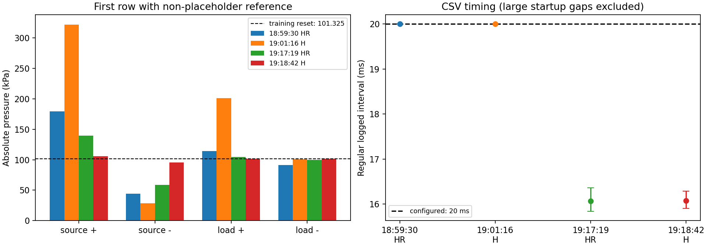
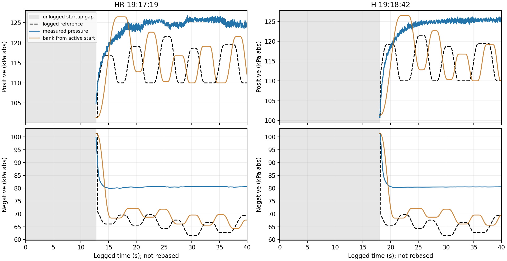
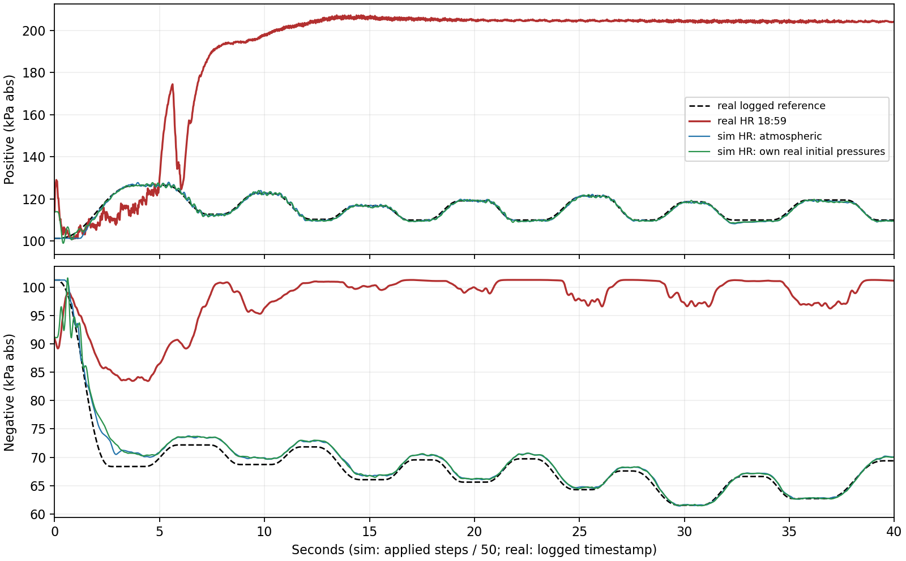
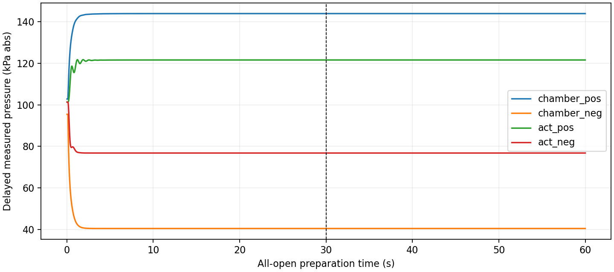
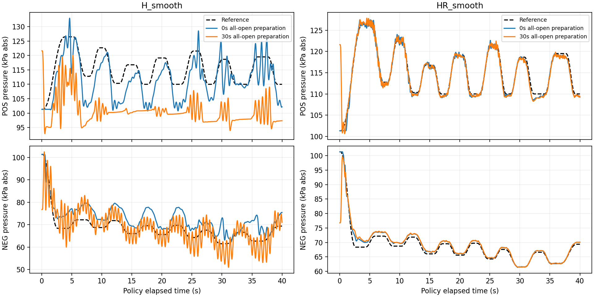

# Lib3 제로샷 결과와 학습 초기 상태 분석

2026-10-15. 분석 기준 코드는 `eeb4d9b`이다. 이 커밋의
[기존 초기화 검토](lib3_sim2real_initialization_review.md)와
[Real 비동기 재학습 설명](real4_async_training.md)을 확인하고,
Drive 원본 4회와 추가 시뮬레이션 14회를 대조했다.
이번 작업은 파일 다운로드·분석·시뮬레이션 평가이며 장비 실행이나 재학습은 하지 않았다.

추가로 **펌프 ON·전체 개방 준비 운전 후 기존 정책으로 전환하는 평가**를 수행했다.
초기 압력만 바꾼 5절의 실험과 구분하며, 결과와 재현 방법은 **9절**에 기록했다.

**현재 판단은 “초기 상태 정합성을 고쳐야 하지만, 초기 압력 때문에 실물 추종이
실패했다고 결론낼 수는 없다”이다.** 실제 HR 시작 압력을 넣은 nominal sim은
여전히 잘 추종한다. 실물에서는 시작 시간·관측 이력 문제가 있으며, 초기 구간
이후에도 추종 실패가 남는다. 먼저 실행 경로와 실제 응답을 확인한 뒤 학습 초기
분포를 바꾸는 순서가 맞다. 현재 운용인 **펌프 상시 ON**을 기준으로 진행한다.

## 1. 내려받은 원본과 비교 범위

원본은 [Drive 실험 폴더](https://drive.google.com/drive/folders/1hSqSdtxOaVqdxTWE5W9G_IN1KgeYfO1W)에 있다.
각 실행의 CSV, cfg, main/ctrl PNG를 받아 총 16개 파일을 보존했다.

- 로컬 원본: `pneu_rl/exp/drive_zeroshot_20261015/`
- 출처·파일 크기·SHA256: `pneu_rl/exp/drive_zeroshot_20261015/drive_download_manifest.json`
- 재현용 [분석 스크립트](../pneu_rl/scripts/analyze_lib3_zeroshot_initial_pressure.py)
- 보존용 [수치·출처 JSON](img/lib3_zeroshot_20261015/analysis_summary.json),
  [구간별 지표 CSV](img/lib3_zeroshot_20261015/tracking_metrics.csv)

| 실행 | 정책 | cfg의 reference | 원본 |
|---|---|---|---|
| 18:59:30 | HR-smooth | bank 0 반복, 약 100초 | [Drive](https://drive.google.com/drive/folders/13neOU-2sSbZcEDGShLP1vug9E_9jS3aN) |
| 19:01:16 | H-smooth | bank 0 반복, 약 100초 | [Drive](https://drive.google.com/drive/folders/1cN4MrkBCuCjrnaowN9X_12nA_l0y4TiU) |
| 19:17:19 | HR-smooth | bank 0, 40초 무반복 | [Drive](https://drive.google.com/drive/folders/1dkX17gVYbgmO_K_iruNhwbsKj9yUbYIE) |
| 19:18:42 | H-smooth | bank 0, 40초 무반복 | [Drive](https://drive.google.com/drive/folders/1kt8E77FwBf-1E8HflCMCgp3xb3FYfB7w) |

정책 이름은 각각 `260831_lib3_histreward2x2_r025_{H,HR}_smooth_seed0`이다.
추천·압축한 모델과 이번 sim 평가는 모두 2000 episode 체크포인트다. 실물 cfg에는
실제 로드한 가중치 SHA나 실행 git SHA가 없어, 실물도 동일한 파일이었는지는
이름만으로 완전히 검증할 수 없다. 다음 기록에는 두 SHA를 남기는 것이 좋다.

## 2. 학습에서 initial pressure는 어떻게 처리했나

선택한 두 모델은 50Hz, K=1, PID OFF, predictor 없음, 물리 명령
`u = 0.8 + 0.2a`를 사용한다. H는 압력·명령 이력과 reference를 받고,
HR은 여기에 압력 변화율 4개를 추가한다.

hard reset에서 만드는 것은 압력 숫자 네 개만이 아니다.

| 항목 | 학습의 hard reset |
|---|---|
| 공급 양압 / 공급 음압 / 부하 양압 / 부하 음압 | 모두 절대압 101.325kPa |
| 압력 history | 위 압력을 11개 관측에 반복해서 채움 |
| 명령 history | 정규화 action 0을 10개 채움; scale 후 0.8에 해당 |
| HR 변화율 | 같은 압력 history에서 0으로 시작 |
| reference | 시간 0에서 시작 |
| 밸브 내부 상태 | simulator reset 규칙으로 초기화 |
| 펌프 내부 상태 | 위상 0, 내부 압력은 공급 압력에 따른 초기화 수식 사용 |

512 step마다 물리 상태를 초기화한 것은 아니다. `episode_carry_blocks=4`로
4개 블록, 즉 2048 step·40.96초를 이어 가며 중간 경계에서는 압력·밸브·펌프·
reference 시간·history를 보존한다. 이후 hard reset한다.
근거는 [env3.reset](../pneu_env/src/pneu_env/env3.py)의 carry 분기와 history 초기화,
[sim3](../pneu_env/src/pneu_env/sim3.py)의 초기 압력 기본값 및
[C++ simulator 초기화](../pneu_env/src/pneu_env/lib3/pneumatic_simulator.cpp)이다.

따라서 **“학습은 대기압만 봤으니 가압된 상태를 전혀 모른다”는 설명은 틀리다.**
정책은 rollout 중 가압·감압된 상태를 본다. 더 정확한 질문은 실물 시작 시의
압력, 숨은 밸브·펌프 상태, 실제 명령/압력 history, reference 위상의 조합을
학습에서 얼마나 보았느냐이다.

실물 [real9.set_init_press](../pneu_env/src/pneu_env/real/real9.py)는 로컬 변수와
buffer를 설정한다. 실제 압력을 대기압으로 만들거나 최신 센서를 읽는 절차가
아니다. 현재 `env3.reset`도 실측 history로 교체되지 않았다.

### Reference와 초기화의 관계

학습 bank는 `lib3_capacity_random_medium_16x4x512_seed61098.npz`의 16개 궤적이다.
각 궤적은 0~40.96초의 2049개 시점이며, 10.24초 블록 4개로 구성된다.
시뮬레이터/PID 응답은 오프라인에서 가능한 압력·변화율 범위와 통과 여부를
정하는 데 사용했다. 저장 reference는 목표 압력이며 PID action을 모방하는
학습 데이터가 아니다. 각 궤적은 대기압에서 시작하도록 설계됐다.

현재 평가는 그 bank의 **0번**이다. 따라서 새로운 ref 일반화 실험은 아니다.
40초 무반복 선택은 40.96초 끝에서 시작값으로 반복되는 점프를 피하고,
0.3초 미래 reference 구간도 남긴다. 가압된 실물에서 같은 ref를 시작하면
초기 복귀 과제도 달라지므로, initial pressure와 ref 시작 조건을 함께 봐야 한다.

## 3. 실물은 서로 다른 압력에서 시작했다

아래는 첫 번째로 0이 아닌 reference가 기록된 행의 압력이다. 전부 절대압 kPa다.
**첫 명령 직전의 동시 측정 상태로 보증된 값은 아니다.** 뒤의 두 실행은 첫 행의
ref가 0이어서 다음 행을 사용했다.

| 실행 | 공급 + | 공급 − | 부하 + | 부하 − | 해당 로그 시각 |
|---|---:|---:|---:|---:|---:|
| 학습 hard reset | 101.33 | 101.33 | 101.33 | 101.33 | 0 |
| HR 18:59 | 179.30 | 44.16 | 113.97 | 91.13 | 0 |
| H 19:01 | 322.08 | 28.23 | 201.14 | 101.22 | 0 |
| HR 19:17 | 139.41 | 58.67 | 104.78 | 99.77 | 12.722 |
| H 19:18 | 105.67 | 95.21 | 101.55 | 101.34 | 17.970 |



초기 조건이 달랐다는 것은 확인된다. 특히 H 19:01의 공급 양압 322kPa는 학습
보상에 설정한 공급 양압 운전 상한 220kPa를 넘는다. 이는 강제 상태 제한이 아니라
계수 0.1의 soft penalty이며 실제 학습에서 방문한 압력 분포의 상한을 뜻하지 않는다.
다만 서로 다른 시작 조건의 단일 실행으로
H와 HR의 실물 우열이나 일반적인 초기 상태 견고성을 결정할 수는 없다.

## 4. 뒤의 두 결과는 정상적인 40초 평가가 아니다

| 항목 | HR 19:17 | H 19:18 |
|---|---:|---:|
| 처음 두 로그 시각 | 0 → 12.722초 | 0 → 17.970초 |
| 첫 행의 양압/음압 ref | 0 / 0 | 0 / 0 |
| 전체 행 수 | 1698 | 1372 |
| 첫 유효 ref 행부터 끝까지의 시간 | 27.284초 | 22.040초 |
| 큰 공백 제외 기록 간격 중앙값 | 16.066ms | 16.077ms |
| 그 간격의 역수 | 약 62.24Hz | 약 62.20Hz |

기존 그래프의 긴 초기 직선은 두 점을 연결한 선이다. 중간 압력·ref를 측정한
것이 아니다. CSV의 ref와 ctrl은 RT에서 돌아온 echo이므로 첫 ref 0은
**정책이 0kPa 목표를 입력받았다는 증거도 아니다.** 이 분석에서는 해당 행을
추종 지표에서 별도로 제외했으며 원본은 그대로 보존했다.

기록된 ref는 시작 대기 이후의 경과 시간보다 기존 로그 절대 시각의 bank 위상에
가깝다. 초기 0.5초를 제외하고 bank 0을 보간하면 `curr_time + 약 0.062~0.063초`에서
joint RMSE가 각각 0.0098/0.0020kPa다. 반대로 첫 유효 ref부터 시간을 새로 센
bank와의 차이는 7.60/8.24kPa다. 이는 **대기 중 시간이 reference 진행에 들어간
현상과 부합하는 기술적 진단**이다. 62~63ms를 물리 지연 추정값으로 해석하면 안 된다.



16ms 간격은 `real_act.wait(margin=0.004)`와도 부합한다. 그러나 이 값은 로그 간격이지
FPGA의 명령 적용 주파수를 검증한 값은 아니다. 앞의 두 100초 결과에 정확히
20ms 간격이 찍혀 있어도 `real9`의 timestamp fallback으로 만들어질 수 있다.

실제 policy 관측도 약 16ms마다 갱신됐다면, 학습에서 0.2초였던 10 interval
history가 약 0.161초로 줄고 `Δp × 50`인 HR 변화율도 실제 유한차분 변화율의
약 0.80배가 된다. 그러므로 freq 설정만 50이라고 해서 입력 의미까지 같은 것은 아니다.

### 초기 이상 행을 빼도 추종 오차는 남는다

| 실행 | 전체 로그 RMSE + / − | 0-ref 행 제외 RMSE + / − |
|---|---:|---:|
| HR 18:59 | 79.151 / 29.702 | 동일 |
| H 19:01 | 15.651 / 11.631 | 동일 |
| HR 19:17 | 10.690 / 14.917 | 10.389 / 14.722 |
| H 19:18 | 10.679 / 15.565 | 10.325 / 15.329 |

단위 kPa, 표본별 RMSE다. 기록 길이·reference 위상·초기 조건이 다르므로
이 표를 맞춰진 정책 비교로 사용하지 않는다. 기존 검토 문서 앞부분의 값은
MAE이며, 여기의 RMSE와 다르다.

뒤의 두 실행에서 로그 30~40초 부하 압력은 각각 **125.32/80.61kPa**, **125.31/80.50kPa**다.
같은 구간의 평균 공급 여유 `P_ch+−P_load+`, `P_load−−P_ch−`는
각각 56.24/38.30kPa, 56.87/37.61kPa다. 단순히 공급 압력이 부족했다는 설명은
이 구간을 바로 설명하지 못한다. 반대로 압력 차가 충분하다는 사실만으로
유량이나 명령 전달이 정상이라고 확인되는 것도 아니다.

## 5. 초기 압력만 바꿔 sim에서 재현되는지 확인했다

두 2000-episode 정책을 고정하고 학습 없이 평가했다. nominal simulator에서
대기압 및 위 4개 측정 압력 조건을 사용해 10회, 뒤의 두 조건에 초기 현재 관측과
pressure history를 가짜 대기압으로 바꾼 근사 실험 4회, 총 **14회**다.
각 실행은 별도 프로세스, bank 0 고정, 50Hz K=1, 2048 physical step·40.96초다.
기존 모델/cfg SHA256이 변하지 않았고 모든 실행의 reference 배열이 같은지 확인했다.

| 정책 | 초기 압력 조건 | 전체 RMSE + / − | 5초 이후 RMSE + / − |
|---|---|---:|---:|
| HR | 대기압 | 0.705 / 1.074 | 0.637 / 0.787 |
| HR | 자기 실물 18:59 측정값 | 1.188 / 1.561 | 0.627 / 0.796 |
| HR | 자기 실물 19:17 측정값 | 0.795 / 1.288 | 0.708 / 0.812 |
| HR | 19:17 압력 + 가짜 초기 관측/history | 0.740 / 1.185 | 0.627 / 0.773 |
| H | 대기압 | 5.610 / 5.343 | 5.681 / 5.395 |
| H | 자기 실물 19:01 측정값 | 10.481 / 4.712 | 5.402 / 3.885 |
| H | 자기 실물 19:18 측정값 | 5.662 / 5.351 | 5.753 / 5.394 |

단위는 kPa다. **bank 0 하나**의 값이므로 이전 16개 궤적 평균과 구분한다.



**적어도 이번 nominal sim에서는 HR 자신의 측정 초기 압력이나, 이 근사적인
초기 관측/history 불일치만으로 실물의 큰 지속 오차를 재현하지 못했다.**
H에는 초기 조건 민감도가 보이므로 두 정책의 초기화를 맞출 필요성은 남는다.

이 실험의 한계는 다음과 같다.

- 동일한 것은 숨은 상태의 reset **규칙**이다. 공급 압력에 따른 초기화 수식 때문에
  펌프 내부 압력도 달라진다. 밸브는 reset되며 실물의 운전 이력은 재현하지 않았다.
- 실물에서 가져온 값은 첫 유효 로그 측정이며 첫 action 전 상태로 확인되지 않았다.
  ref는 0초에서 시작하므로 실물의 12.7/18초 대기나 약 16ms 주기를 재현하지 않았다.
- fake variant는 초기 현재 압력 입력과 pressure history를 함께 바꾸는 근사 실험이다.
  실제 실행에서 사용한 policy state를 직접 재현한 것은 아니다.
- H 실물의 공급 322kPa 조건을 HR에 넣은 별도 stress test에서는 simulator가 크게 발산했다.
  이는 HR 자신의 실험 초기 조건이 아니고 설정 운전 범위 밖의 외삽이다.
  실제 압력 상승량이나 이번 HR 실패 원인의 근거로 사용하지 않는다.
- 단일 bank member·단일 체크포인트 결과이므로 일반적인 견고성을 입증하지 않는다.

실행 코드는 [SIM 전용 script](../pneu_rl/scripts/analyze_lib3_initial_pressure_counterfactual.py),
전체 결과는 `pneu_rl/exp/lib3_initial_pressure_counterfactual_261015/`에 있다.
주요 수치와 입력 SHA는 보존용 JSON에도 넣었다.

## 6. 최신 push에서 해결된 것과 남은 것

| 항목 | `eeb4d9b` 상태 |
|---|---|
| `.8..1` scale을 모델 설정에서 읽기 | 반영됨 |
| bank 0 고정, 40초 무반복 | 반영됨 |
| 펌프 OFF → ON 후 Enter 시작 대기 | 제거됨; 상시 ON 즉시 평가로 원복 |
| 종료 시 물리 명령 6개 1.0 기록 | 반영됨; RT 적용 확인 신호는 아님 |
| Real 재학습 프로세스 분리 | 반영됨; zero-shot gradient update와는 별개 |
| retrain3 보상/CAPS 강제 덮어쓰기 제거 | 반영됨 |
| 실측 pressure/action history로 초기화 | 아직 미반영 |
| 현재 명령과 새 관측의 대응·freshness 확인 | 아직 미반영 |
| 실제 50Hz 제어/관측 주기 보장 | 아직 미반영 |

최신 시작 표식은 `continuous_pump_on_no_start_wait`다. 받은 네 결과에는 이 표식이
없으며, H 19:18에만 과거 수동 펌프 OFF 진단 표식이 있다. 최신 코드가 과거 로그에도
적용됐다고 해석하지 않는다. 네 CSV 모두 명령이 0.8 부근까지 내려가므로 예전
`.85 + .15a`만으로 이번 실패를 설명할 근거도 없다.

## 7. 이제 initial pressure와 학습은 어떻게 할까

**다음 행동은 “대기압 학습을 바로 버리고 재학습”이 아니라, 상시 ON에서 실제
입력과 명령이 맞는지 확인하고 그 시작 상태를 sim에 재현하는 것**이다.

1. **실행 시간과 관측의 기준부터 정한다.** 기존 로그는 보존한다. 새 평가에서는
   준비 전 관측과 실제 시작 관측을 구분하고, ref clock은 준비 완료 후 0초에서
   시작한다. 명령 전송/관측 수신의 단조 시각, raw RT 시각, fallback 여부,
   로컬 ref·명령과 RT echo를 함께 남긴다. 표시 시간을 다시 매기는 것만으로
   이미 건너뛴 ref 구간이 복구되지는 않는다.
2. **모델이 학습한 20ms 관측 간격과 history를 맞춘다.** actor 간격과 관측 age를
   실제 계측한다. 약 16ms 수신이라면 50Hz로 선택/재표본화하는 경로를 정하고
   중복·오래된 센서값을 구분한다. `freq=50`만 설정하거나 변화율만 보정해서
   압력/action history의 시간 의미가 모두 맞는다고 간주하지 않는다.
3. **펌프 ON의 시작 상태를 정의한다.** 후보는 기존 문서의 “상시 ON + 물리 명령
   전체 개방에서 안정된 상태”다. 이때 압력 네 개가 대기압이라고 가정하지 않는다.
   실제 압력·명령 이력을 수집하고, sim에서도 같은 준비 명령을 충분히 실행해
   압력·밸브·펌프 상태와 history를 함께 얻는다. 실물 준비 명령의 전달과 응답을
   확인하기 전에는 새 표준이 구현됐다고 부르지 않는다.
4. **실물 policy도 실제 이력으로 시작한다.** 11개 압력 샘플이 커버하는 0.2초와
   명령 10개의 이력을 확보하고, HR rate도 이 이력에서 계산한다. 이전에 내보낸
   물리 명령을 정규화 action으로 바꿔 이력에 반영한다. 지연이 있다면 이력과
   명령의 대응도 맞춘다. 안정화 시간과 history 수집 시간은 서로 다른 조건이다.
5. **그 뒤에 sim 재학습 필요성을 결정한다.** 상시 ON 시작이 기존 정책에 어렵다면
   위 준비 rollout에서 얻은 도달 가능한 여러 상태를 학습 시작점으로 사용한다.
   네 압력을 독립 난수로 바꾸고 밸브/history를 전부 0으로 두는 것으로
   상시 운전의 시작 분포를 재현했다고 주장하지 않는다. 기존 대기압 시작 정책과
   준비 상태 학습 정책을 같은 실행 경로에서 비교한다.

준비 이후에도 125/80kPa 부근에 머무는 현상이 반복되면, 밸브 채널별 명령 변화가
RT에 전달되는지와 센서/유량 응답이 sim과 같은 방향·크기로 바뀌는지를 먼저
분리한다. 이 확인 없이 큰 오차를 SAC 적응이나 누설 계수로 흡수하면 실행 문제와
모델 차이를 구분하기 어렵다. 지금 결과는 누설 변화·노화·HR 구조 실패를
특정한 증거가 아니다.

이 단계가 정리되면 같은 bank 0에서 짧은 zero-shot 비교를 다시 하고, 그 다음에
새 reference와 제한된 fine-tuning 데이터 예산을 평가한다. 새 학습 구조나
adaptation 방법의 효과를 주장할 기준 결과는 그때 확보하는 것이 타당하다.

## 8. 분석 재현

저장된 원본과 기존 모델을 사용한다. 아래 명령은 장비에 연결하지 않는다.

```bash
cd /home/rise/test/brl_window_v2
source ./activate_env.sh

# 14개 시뮬레이션: 기존 가중치 고정, 실물/학습 실행 없음
python pneu_rl/scripts/analyze_lib3_initial_pressure_counterfactual.py --include-fake-history

# Drive 원본 4회 지표와 그림, 위 sim 결과를 묶은 JSON 재생성
python pneu_rl/scripts/analyze_lib3_zeroshot_initial_pressure.py
```

`pneu_rl/exp/`와 원래 모델 폴더는 Git 제외 대상이다. 다른 PC에서 재현하려면
위 Drive 원본과 모델 패키지가 필요하다. sim script는 모델 폴더의
`model_epi_2000.pth`를 우선 읽고, 없으면 compact 패키지의 `model.pth`를 읽는다.
어느 경로든 이번에 선택한 2000-episode 가중치의 SHA256을 확인한다.
새 MD·분석 script·보존용 그림/수치에는
다운로드한 실제 실행 결과와 sim 평가의 출처·제약을 함께 기록했다.

## 9. 추가 검증: 전체 개방 준비 운전 후 기존 H·HR 전환

사용자가 선택한 다음 두 작업을 수행했다. simulator를 전체 개방으로 실제 진행해
시작 상태를 만들고, 그 물리 상태와 history를 유지한 채 기존 2000-episode 정책을
학습 없이 실행했다. 압력 네 값만 대입한 5절의 실험과 다른 검증이다.

### 구현과 비교 조건

[평가 스크립트](../pneu_rl/scripts/evaluate_lib3_all_open_start.py)의
`prepare_all_open()`에서 여섯 정규화 action을 모두 1로 유지한다.
기존 scale에서 물리 명령도 여섯 개 모두 1이며, 실제 simulator에 전달되는 값을
매 step 확인한다. simulator의 기존 펌프 동역학은 계속 진행한다.

준비 중 얻은 마지막 압력 11개와 명령 10개를 policy history로 사용한다.
정책 전환 때 `set_init_press`, `time_reset`, `env.reset`을 다시 부르지 않는다.
따라서 압력·펌프·밸브 상태와 sensor delay buffer가 같은 실행에서 이어진다.
정책 state를 구성하는 과정에서 simulator 시간, 밸브 debug state,
sensor delay buffer가 변하지 않는지 assertion으로 확인했다.

현재 로컬 `.so`에는 전체 augmented-state 조회 함수가 export되어 있지 않다.
따라서 저장된 snapshot을 복원하는 방식을 사용하지 않고 연속 운전으로 상태를
보존했다. 모든 숨은 상태를 배열로 직접 비교했다고 주장하지 않는다.
실행 결과에는 사용한 simulator binary SHA256도 기록했다.

| 항목 | 설정 |
|---|---|
| 정책 | 기존 H-smooth / HR-smooth, 선택된 2000 episode 가중치 고정 |
| 준비 운전 | 0초(대기압 baseline), 전체 개방 30초, 전체 개방 60초 |
| 평가 | 각 조건에서 40초·2000 step, 50Hz K=1 |
| reference | 학습 bank 0, 모든 실행에서 동일 배열 확인 |
| history | 준비 운전의 실제 압력·정규화 명령 이력 |
| reward / 학습 | 기존 reward로 기록; gradient update와 replay 수집 없음 |
| 원본 모델 | 전후 cfg/가중치 SHA256 일치 확인 |

Reference 시간은 모든 비교에서 `정책 step / 50`으로 통일한다. 준비 운전으로
진행된 simulator 물리 시간과 지연된 센서 시각은 그대로 둔다. 준비 시간 때문에
bank 앞부분을 건너뛰지 않도록 평가 스크립트에서 reference 시각만 지정한다.
이는 공통 환경의 training/real 시간 처리를 수정한 것이 아니다.
이전 5절의 40.96초·기존 관측 기반 ref 시계와 약간 다르므로, 이번 0초 baseline과
30/60초 조건끼리 비교한다.

### 전체 개방 시작 상태

30초 준비 후 마지막 지연 관측 압력은 다음과 같다. 단위는 절대압 kPa다.

| 공급 + | 공급 − | 부하 + | 부하 − |
|---:|---:|---:|---:|
| 143.977 | 40.412 | 121.614 | 76.774 |

30초 준비의 마지막 5초 평균과 그 앞 5초 평균 차이는 네 채널 모두
0.000001kPa 미만이다. 30초와 60초 종료 압력도 사실상 같다.
이번 nominal simulator에서는 **30초를 충분히 정착한 준비 조건으로 선택할 수 있다.**
이는 실물에서도 반드시 30초를 기다려야 한다는 뜻이나 최소 준비 시간을 찾았다는
뜻은 아니다. H·HR이 정책을 켜기 직전 같은 압력과 밸브 debug state를 갖는지도 확인했다.



### 기존 정책의 반응

아래 값은 두 부하 압력 채널의 오차 제곱을 함께 평균한 combined RMSE다.
단위는 kPa이며, 실물 비교가 아닌 nominal sim 내 비교다.

| 정책 | 시작 방식 | 전체 40초 | 처음 5초 | 5초 이후 |
|---|---|---:|---:|---:|
| H | 대기압 baseline | 5.473 | 5.201 | 5.511 |
| H | 전체 개방 30초 후 전환 | 11.606 | 12.169 | 11.523 |
| H | 전체 개방 60초 후 전환 | 11.606 | 12.169 | 11.523 |
| HR | 대기압 baseline | 0.896 | 1.663 | 0.722 |
| HR | 전체 개방 30초 후 전환 | 2.028 | 5.369 | 0.763 |
| HR | 전체 개방 60초 후 전환 | 2.025 | 5.369 | 0.753 |



**H는 전체 개방 상태에서 시작하면 지속 오차가 커졌다. HR은 전환 직후 오차가
커지지만, 5초 이후에는 대기압 baseline과 비슷한 추종 성능을 보였다.**
따라서 두 정책 모두 시작 조건과 무관하게 잘 제어한다고 말하면 안 된다.
30초와 60초 준비 차이는 이번 결과의 주요 차이를 설명하지 않는다.

이번 실험은 준비 운전 history까지 정합하게 넘긴 경우다. 실물 코드가 초기
history를 대기압·0 명령으로 덮어쓰는 현상은 여기서 재현하지 않았다.
실물의 시작 압력, 모델 차이, 명령 적용과 관측 시각 문제도 별개다.
이 한 궤적 결과만으로 실물 gap의 원인을 확정하거나 2000 episode 재학습의
성공을 보장할 수는 없다. 다만 전체 개방 준비 조건으로 새 학습을 비교할
baseline은 확보했다.

### 16ms와 reference 시작 시간 문제의 의미

이 문제는 **학습 중 한 번 튕겼다는 기록을 말하는 것이 아니다.**
19:17/19:18 실물 평가 CSV에서 처음 두 시각이 0→12.722초,
0→17.970초로 뛰고, 이후 기록 간격 중앙값은 약 16.07ms였다는 관찰이다.
당시 시작 대기가 reference 시간과 섞이는 실행 경로가 있었고, 최신 코드에서는
그 대기 절차를 제거했다. 다만 대기 제거만으로 실제 20ms 제어·관측 간격과
명령/관측 대응이 검증되는 것은 아니다.
이번 sim 평가는 50Hz로 정확히 step하며 reference 시각을 분리했으므로
그 실물 로그 문제를 끌어와 평가하지 않는다.

### 결과 파일과 재현

- 원본 준비 운전/평가 CSV: `pneu_rl/exp/lib3_all_open_start_20261015/`
- [보존용 summary](img/lib3_all_open_start_20261015/summary.json)
- [구간별 지표](img/lib3_all_open_start_20261015/metrics.csv)

```bash
cd /home/rise/test/brl_window_v2
/home/rise/miniconda3/envs/env_1/bin/python pneu_rl/scripts/evaluate_lib3_all_open_start.py
```

위 명령은 6개 sim 평가와 그림/수치를 재생성한다. 실물에 연결하지 않으며
학습도 시작하지 않는다. 실제 학습 reset에 이 준비 방식을 연결하는 작업은
이번 평가와 구분한다.

## 10. 전체 개방 초기화로 H·HR 각각 2000 episode 새 학습

학습용 [PneuEnv3AllOpen](../pneu_env/src/pneu_env/env3_all_open.py)을 추가했다.
hard reset에서만 30초 전체 개방 준비를 실행하고, 중간 carry 경계에서는
물리 상태·history·reference 시간을 유지한다. Reference 시간은 policy step/50이며
준비 운전은 replay나 512-step 학습 horizon에 포함되지 않는다.

[실행 스크립트](../pneu_rl/scripts/train_lib3_all_open.py)는 기존 H/HR-smooth의
cfg를 각각 읽어 reward, bank, seed 0, SAC 설정을 유지하며 새 네트워크와 새 replay로
시작한다. 기존 가중치를 이어서 학습하는 명령이 아니다. 초기화·reference 시계 변경과
함께 checkpoint 저장 간격은 500 episode로 설정했다. `model.pth`는 기존 SAC처럼
매 episode 갱신되고, 500/1000/1500/2000 파일도 남는다.
같은 이름의 모델 폴더가 있으면 덮어쓰지 않고 종료한다.

학습 component factory와 `evaluate_lib3_screening.py`는 저장 cfg의
`initialization.mode=pump_on_all_open`을 읽어 같은 초기화를 적용한다.
실물 실행의 초기화 경로는 별도 검증이 필요하다. 이후 `quick_viz3.py`의
Sim 경로도 동일 초기화를 사용하도록 수정했다(아래 11절).

두 모델을 별도 프로세스로 병렬 실행하려면 다음 명령을 사용한다.

```bash
cd /home/rise/test/brl_window_v2
nohup bash pneu_rl/scripts/run_lib3_all_open_2000.sh > /tmp/lib3_all_open_launch.log 2>&1 &
```

진행 확인:

```bash
tail -f pneu_rl/exp/lib3_all_open_training_logs/H.log pneu_rl/exp/lib3_all_open_training_logs/HR.log
```

결과 모델 폴더는 다음과 같다.

- `pneu_rl/models/261015_lib3_allopen30_H_smooth_seed0/`
- `pneu_rl/models/261015_lib3_allopen30_HR_smooth_seed0/`

위 일괄 launcher의 기본값은 thread 1이다. 사용자가 별도 명령으로 시작한 실제
H/HR 실행은 각각 `--threads 2`이며 두 `wall_time.json`/`cfg.yaml`에서도 2를 확인했다.
새 실행은 `wall_time.json`에 실제 시작·종료 시각과 소요 시간을 저장한다.

### 예상 시간의 근거

기존 cfg 수정 시각부터 2000 checkpoint 수정 시각까지를 비교했다.
파일 timestamp 기반 추정이므로 중단·경합 등의 영향을 분리한 순수 계산 시간은 아니다.

| 기존 실행 | cfg 시각 | 2000 checkpoint 시각 | 경과 |
|---|---|---|---|
| H-smooth | 2026-08-31 23:21:13 KST | 2026-09-01 03:01:07 KST | 약 3시간 40분 |
| HR-smooth | 2026-08-31 23:25:43 KST | 2026-09-01 03:10:08 KST | 약 3시간 44분 |

두 실행 시간은 서로 겹친다. 1000→2000 구간은 각각 약 2시간 5분, 2시간 7분으로
학습 후반이 초반보다 느렸다. 이번 준비 운전 비용과 저장/경합을 고려해
**두 모델 병렬 실행 완료까지 약 4~5시간**을 작업 계획용 추정으로 사용한다.
하나씩 순차 실행한다면 대략 8~10시간을 잡는다. 현재 CPU 부하 등에 따라 달라진다.

짧은 실제 업데이트 검증에서는 5 episode·2560 step이 약 27.2초에 끝났다.
이 검증은 작은 replay, warmup 생략, 디스크 로그 없음 조건이므로 그 시간을
2000배로 환산한 값을 본학습 예상 시간으로 사용하지 않았다.

검증: H/HR 두 dry-run, 평가용 준비 상태와 학습용 초기 policy state 일치,
carry/hard-reset 및 reference clock 테스트 3개, 실제 SAC 업데이트 5 episode.
이 검증에서 본학습 모델 폴더를 만들거나 기존 모델을 변경하지 않았다.

## 11. quick_viz 평가 경로 점검 및 후속 검증 예약

2026-10-15 저녁 수정:

- `quick_viz3.py`는 모델 cfg의 `initialization.mode=pump_on_all_open`을 읽어
  Sim에서는 `PneuEnv3AllOpen`을 생성한다. 준비 운전 뒤 내부 상태와 history를 유지한다.
- 준비 운전의 물리 시각(약 30초)을 40초 평가 종료 조건에 사용하지 않는다.
  정책 시계로 0→40초, 50Hz에서 정확히 2000 step을 실행한다.
- CSV `curr_time`은 준비된 Sim에서 정책 경과 시간, `sensor_time`은 원래 관측 시각,
  `reference_time`은 해당 step의 reference 조회 시각이다. 마지막 두 시각을 구분하여
  센서 지연과 reference 정렬을 추적한다. 기존 일반 Sim/Real `curr_time` 의미는 유지한다.
- 기본 reference는 선택 모델의 bank 0, 40초, 반복 없음이다. bank 길이가
  평가 40초와 미래 preview를 포함하는지 검사한다. 현재 bank는 40.96초다.
- 저장 cfg에 학습 초기화 설정, 실제 실행 protocol, reference clock, history 초기화 방식,
  정책 env 설정을 기록한다. Real에는 Sim 준비 운전을 자동 적용하지 않는다.
  따라서 새 모델로 Real을 선택하더라도 실측 history 초기화가 구현되었다는 뜻은 아니다.
- H 156차원/HR 160차원, ref 첫 조회 0초, 2000 step, 센서 시각 약 70초까지 보존,
  종료 1회 및 기존 모델/명령 스케일/실물 bridge mock 회귀 검증 총 7개 통과.
  이것은 시간·초기화 경로 검증이며 학습 정책의 성능 평가는 아니다.

후속 결과 검증은 로컬 사용자 systemd 타이머
`brl-training-review-20261016.timer`로 **2026-10-16 01:30 KST**에 1회 예약했다.
PC와 사용자 세션이 유지되고 Codex 연결이 가능해야 한다. 최대 실행 시간은 2시간이다.
학습 중단/재학습/실물 제어 없이 완료 checkpoint를 평가하고 아래 보고서를 생성하도록 했다.

- 예정 보고서: `docs/lib3_all_open_training_review_20261016.md`
- 작업 지시 및 실행 로그: `pneu_rl/exp/scheduled_review_20261016/`
- 검증: 실제 완료 여부, 1000/1500/2000 비교(존재하는 경우), 동일 초기화와 reference,
  초기 5초/이후 추종 오차, 압력 범위, 명령 포화·진동, quick viz 설정, 실물에서 남은 불확실성.
- 학습 bank 평가는 미학습 reference 일반화의 증거로 취급하지 않는다.
  미완료이면 확인 가능한 checkpoint와 남은 작업을 보고한다.
